# ⚡ PRODUCTIVITY & AI AGENT REPOSITORY CATALOG
### The Ultimate Toolkit for Developer Velocity, Autonomous Coding Agents, Testing Discipline & Infrastructure

> **Purpose:** This catalog groups, ranks, and details every repository dedicated to **Developer Productivity, AI Coding Agents, Software Engineering Methodology, Multi-Agent Reasoning, Security Auditing, Sandboxing, and Self-Hosted Infrastructure**.
> Use this reference guide across any software engineering project to supercharge code velocity, enforce rigorous testing, and deploy production-grade agentic workflows.

---

## 🏛️ Modern Developer Productivity Architecture

The tools in this catalog create a complete, closed-loop development and execution ecosystem:

```mermaid
graph TD
    subgraph PlanningAndMethodology["1. Methodology & Discipline"]
        SP[obra/superpowers<br/>TDD, Specs, Plans, Systematic Debugging]
        GSTACK[garrytan/gstack<br/>YC Startup Team: Office Hours, CEO/Eng/Design Review, QA Browser & Ship]
        REP[replica-skill<br/>Clean-Room Architecture & Parity]
    end

    subgraph AgentExecution["2. Coding Agents & Model Gateways"]
        NC[nanocoder<br/>100% Open Terminal Agent & Worktrees]
        FCC[free-claude-code<br/>Claude Code Router & Free Endpoints]
        EDG[Edge0<br/>35B MoE Local Inference in 2.5GB RAM & NVMe Streaming]
        OD[open-dots<br/>Agent Sandboxes, Runner & Telegram Bot]
        CLIP[paperclip<br/>Zero-Human Company OS & Multi-Agent Control Plane]
    end

    subgraph ReasoningAndVerification["3. Verification & Adversarial Consensus"]
        CAS[security-audit-skill<br/>6-Phase Multi-Agent Security Audit]
        ARN[arena-skill<br/>16-100 Agent Adversarial Tournament]
        MF[MiroFish<br/>Swarm Simulation & Scenario Forecasting]
    end

    subgraph CoreInfra["4. Developer Infrastructure & Storage"]
        ASH[awesome-selfhosted<br/>1,500+ Self-Hosted Services Directory]
        NZB[nzbdav / infinidysk<br/>Zero-Storage Streaming & Virtual FS]
        FILESYNC[FileSync<br/>P2P WebRTC Direct File Streaming & No Size Cap]
        WALLY[Wally<br/>Self-Hosted Financial Ledger & Expense Tracker]
        FILEE[Filee<br/>Offline 240+ Format Converter CLI & Watcher]
        YOUPI[YouPI-PG<br/>0% Fee Self-Hosted UPI Gateway]
        HUM[Turnitout Humanizer<br/>Deterministic Document & Code Sanitizer]
    end

    PlanningAndMethodology --> AgentExecution
    AgentExecution --> ReasoningAndVerification
    ReasoningAndVerification --> CoreInfra
```



---

## 🏆 Master Prioritization Matrix

Repositories are ranked by their direct impact on developer velocity and code quality:

| Priority Tier | Repository | Primary Stack & Language | Core Productivity Superpower |
| :--- | :--- | :--- | :--- |
| **Tier 1: Essential** | [garrytan/gstack](https://github.com/garrytan/gstack.git) | TypeScript / Node.js / Playwright / Agent Skills | Opinionated YC startup engineering team suite by Garry Tan; simulates CEO, Eng Manager, Designer, autonomous Playwright browser QA daemon, and Release Manager (`/office-hours`, `/plan-ceo-review`, `/plan-eng-review`, `/plan-design-review`, `/qa`, `/ship`, `/learn`). |
| **Tier 1: Essential** | [obra/superpowers](https://github.com/obra/superpowers.git) | Agent Skills / Markdown Protocol / Shell | Enforces rigorous software engineering: spec extraction, TDD discipline, subagent delegation, and pre-completion verification. |
| **Tier 1: Essential** | [Nano-Collective/nanocoder](https://github.com/Nano-Collective/nanocoder.git) | TypeScript / Node.js (>=22) / Ink / MCP | 100% open-source terminal coding assistant; zero telemetry, local Ollama or cloud model switching, isolated git worktrees, and PR review. |
| **Tier 1: Essential** | [Alishahryar1/free-claude-code](https://github.com/Alishahryar1/free-claude-code.git) | Python (FastAPI) / Reverse Proxy | Eliminates Claude Code API billing; translates Anthropic calls to free cloud tiers (NVIDIA NIM, OpenRouter) or local models (Ollama). |
| **Tier 1: Essential** | [cloudflare/security-audit-skill](https://github.com/cloudflare/security-audit-skill.git) | Node.js Validators / Agent Skill | Turns coding agents into rigorous security auditors; enforces 6-phase vulnerability discovery, coverage ledgers, and adversarial disprovers. |
| **Tier 1: Essential** | [Edge0-AI/Edge0](https://github.com/Edge0-AI/Edge0.git) | C++ / Python / Metal & MLX / DirectStorage & CUDA / MoE NVMe Streaming | Enables running heavyweight 35B MoE reasoning models locally in ~2.5–3 GB RAM; eliminates cloud API costs for coding agents via a built-in OpenAI-compatible server. |
| **Tier 2: Advanced** | [paperclipai/paperclip](https://github.com/paperclipai/paperclip.git) | Node.js (TypeScript) / React UI / PostgreSQL / pnpm | Open-source control plane for zero-human companies; orchestrates multi-agent teams with Linear-style ticket boards, organizational hierarchies, heartbeat scheduling, and budget hard-stops. |
| **Tier 2: Advanced** | [Anil-matcha/open-dots](https://github.com/Anil-matcha/open-dots.git) | Python (FastAPI) + Next.js 16 / Docker | Open-source alternative to paid agent sandboxes (Manus, OpenAI Operator); runs agents in isolated Docker sandboxes with Telegram remote control. |
| **Tier 2: Advanced** | [Jakeschincariol/arena-skill](https://github.com/Jakeschincariol/arena-skill.git) | Python Engine / Multi-Agent Tournament | Solves difficult reasoning and architectural decisions by pitting 16–100 sub-agents in a knock-out debate tournament. |
| **Tier 2: Advanced** | [Jakeschincariol/replica-skill](https://github.com/Jakeschincariol/replica-skill.git) | Python CLI Tooling / Agent Skill | Step-by-step methodology to reverse-engineer and rebuild any commercial SaaS into clean-room, production code with automated parity testing. |
| **Tier 2: Advanced** | [morluto/rea](https://github.com/morluto/rea.git) | Clean Architecture Scaffolding | Developer tooling and architecture templates for modular, maintainable full-stack systems. |
| **Tier 2: Advanced** | [melgarafael/DeskcommCRM](https://github.com/melgarafael/DeskcommCRM.git) | Next.js 16 / React 19 / Supabase / MCP Server / WAHA | AI sales operating system with built-in MCP server; assigns autonomous LLM agents to CRM pipelines with RAG knowledge bases and automated follow-ups. |
| **Tier 2: Advanced** | [DozenTwelve/Papermorph](https://github.com/DozenTwelve/Papermorph.git) | Agent Skill (`SKILL.md`) / Python / SVG / Web Audio | Transforms static PDF documentation, whitepapers, and textbooks into animated, interactive web books and 1080p explainer videos. |
| **Tier 2: Advanced** | [latent-spaces/brag](https://github.com/latent-spaces/brag.git) | Universal Agent Skill (`SKILL.md`) / Node.js / Hyperframes | Inspects codebases and git repositories to autonomously write narrative storyboards and render high-production 20-second 60FPS launch videos with social copy (`/brag`). |
| **Tier 2: Advanced** | [ScrapeGraphAI/Scrapegraph-ai](https://github.com/ScrapeGraphAI/Scrapegraph-ai.git) | Python 3.10+ / LangChain / Playwright / Multi-LLM / MCP | LLM graph-based web scraping framework; replaces brittle XPath/CSS selectors with dynamic DAG pipelines (`SmartScraperGraph`, `SearchGraph`, `OmniScraperGraph`) and an MCP server. |
| **Tier 3: Infra & Data** | [polius/FileSync](https://github.com/polius/FileSync.git) | Python 3.14 (FastAPI) / WebRTC DataChannels / Alpine Docker | Private browser-to-browser P2P file transfers with no size limit; flat memory usage streaming directly to disk, automatic resume, and multi-cast broadcasting without cloud storage or egress fees. |
| **Tier 3: Infra & Data** | [polius/Wally](https://github.com/polius/Wally.git) | Python 3.12+ (FastAPI) / SQLModel / AG Grid / Docker | Lightweight (~32MB) self-hosted expense and budget tracker; AG Grid data table with multi-field filtering, income/expense analytics, recurring transactions, and built-in REST API. |
| **Tier 3: Infra & Data** | [awesome-selfhosted/awesome-selfhosted](https://github.com/awesome-selfhosted/awesome-selfhosted.git) | Curated Knowledge Base / Static Web | The ultimate catalog of 1,500+ self-hostable tools (CI/CD, git hosting, databases, monitoring, internal auth) to replace costly SaaS tools. |
| **Tier 3: Infra & Data** | [AhmadHassan-BTed/Turnitout-Humanizer](https://github.com/AhmadHassan-BTed/Turnitout-Humanizer.git) | Python / Deterministic Rule Engine | High-speed offline document processing; sanitizes and strips tracking metadata without altering LaTeX math formulas, Word formatting, or code. |
| **Tier 3: Infra & Data** | [nzbdav-dev/nzbdav](https://github.com/nzbdav-dev/nzbdav.git) | C# / .NET / WebDAV / NNTP / Docker | Zero-storage virtual filesystem streaming architecture; mounts remote archive data streams on-demand without writing to disk. |
| **Tier 3: Infra & Data** | [KnifeLemon/Filee](https://github.com/KnifeLemon/Filee.git) | C# / .NET 10 / Avalonia / CLI / FFmpeg & Pandoc | Free, 100% offline file converter for 240+ formats; zero MS Office dependency, radial cursor donut UI, watch daemon, and CLI (`filee`). |
| **Tier 3: Infra & Data** | [youpi-pg/YouPI-PG](https://github.com/youpi-pg/YouPI-PG.git) | Node.js (v20+) / Express / SQLite WAL / Android Observer / Webhooks | Sovereign, self-hosted, 0% fee UPI payment gateway; verifies payments via tri-channel notification mesh (Android app, Gmail, UTR) with dynamic SVG QR codes. |
| **Tier 3: Infra & Data** | [Jakeschincariol/trader-skill](https://github.com/Jakeschincariol/trader-skill.git) | Python / SEC EDGAR & Congressional APIs | Financial intelligence and risk gatekeeper; parses SEC EDGAR 13F hedge fund filings and congressional stock disclosures automatically. |
| **Tier 3: Infra & Data** | [Oldcircle/geo-sleuth](https://github.com/Oldcircle/geo-sleuth.git) | Python 3.10+ / OpenStreetMap / Solar Math | Precise geolocation intelligence; pinpoints photo origins down to ±2m using sun shadows, skyline elevation profiles, and vector maps. |
| **Tier 3: Infra & Data** | [stupside/castor](https://github.com/stupside/castor.git) | Go 1.24+ / Headless Chrome / FFmpeg / DLNA | Headless stream sniffer and real-time media transcoder; casts web video to smart TVs without screen mirroring latency. |
| **Tier 3: Infra & Data** | [veops/oneterm](https://github.com/veops/oneterm.git) | Go / Vue.js & Ant Design / MySQL & Redis | Lightweight enterprise bastion host & jump server (4A security model); WebSSH/RDP, credential vaults with automated rotation, session video logs, and command blacklisting. |
| **Tier 3: Infra & Data** | [evolution-foundation/evolution-api](https://github.com/evolution-foundation/evolution-api.git) | TypeScript / Node.js / Baileys & Meta Cloud API | Multi-channel WhatsApp & messaging REST API; multi-tenant instances (QR code connect), message queues, webhooks, and AI bot connectors. |
| **Tier 3: Infra & Data** | [Katzca/AutoSocial](https://github.com/Katzca/AutoSocial.git) | Node.js (>=18) / Express / Playwright / FFmpeg / yt-dlp | Local multi-account automation dashboard & scheduler; automated Playwright browser workflows with persistent profiles and FFmpeg media uniquifier. |
| **Tier 3: Infra & Data** | [harry0703/MoneyPrinterTurbo](https://github.com/harry0703/MoneyPrinterTurbo.git) | Python 3.11+ / FastAPI / Edge-TTS / Whisper / MoviePy / Docker | Headless automated text-to-video assembly pipeline; multi-LLM script generation, free Edge-TTS neural speech, Faster-Whisper alignment, and Docker API. |
| **Tier 3: Infra & Data** | [666ghj/MiroFish](https://github.com/666ghj/MiroFish.git) | Python 3.11+ / Vue.js / CAMEL-AI OASIS / GraphRAG / Zep | Swarm simulation & scenario prediction engine; populates digital parallel worlds to model complex real-world social outcomes (research/experimental). |

---

## 🥇 Tier 1: Essential Coding Agents & Engineering Disciplines

### 1. [obra/superpowers](https://github.com/obra/superpowers.git)
- **Primary Stack:** Universal Agent Skill Definitions / Shell & Node.js hooks
- **Core Problem Solved:** AI coding assistants frequently jump straight into writing code without understanding the full specification, skip test suites, or hallucinate fixes when debugging. `superpowers` enforces a battle-tested engineering discipline on your agent.
- **Key Modules & Skills:**
  1. `brainstorming`: Interviews you systematically to uncover edge cases and extract crystal-clear requirements before touching code.
  2. `writing-plans` & `executing-plans`: Deconstructs complex tasks into bite-sized, verifiable implementation steps.
  3. `test-driven-development` (TDD): Enforces a strict Red-Green-Refactor testing cycle. Tests are written and verified failing before any implementation code is authored.
  4. `systematic-debugging`: Mandates evidence-driven root-cause analysis (inspecting logs, reproducing failures, tracing call stacks) rather than guessing.
  5. `verification-before-completion`: Automatically runs test suites, linters, and build commands before declaring work complete.
- **How to Use in Daily Development:**
  - Install directly into your Antigravity or agent environment:
    ```bash
    agy plugin install https://github.com/obra/superpowers
    ```
  - Use `superpowers` skills at the start of any new feature or bugfix to guarantee zero regressions and 100% test coverage.

---

### 2. [Nano-Collective/nanocoder](https://github.com/Nano-Collective/nanocoder.git)
- **Primary Stack:** TypeScript / Node.js (>=22) + Ink (React in Terminal) + MCP + Git Worktrees
- **Core Problem Solved:** Proprietary coding assistants (Cursor, Claude Code, GitHub Copilot) require monthly subscriptions, enforce proprietary rate limits, collect developer telemetry, or block local model usage. `nanocoder` is a **100% open-source, non-profit terminal coding assistant with zero telemetry**.
- **Key Capabilities & Features:**
  1. **Ink TUI Interface:** Rich terminal experience with custom spinners, colored status badges, and interactive keyboard navigation. Supports both fullscreen `alt-screen` and inline `--no-alt-screen` modes.
  2. **Multi-Model Provider Freedom:** Works seamlessly with local models (Ollama, llama-cpp) and any cloud provider (OpenRouter, Requesty, Anthropic, Gemini, OpenAI).
  3. **Five Operational Modes:**
     - `normal`: Interactive human-in-the-loop with approval prompts.
     - `auto-accept`: Non-blocking safe file modifications.
     - `yolo`: Completely autonomous execution for automated scripts and headless CI/CD.
     - `plan`: Read-only discovery and architectural planning (no file mutations).
     - `architect`: High-level system design and task decomposition.
  4. **Isolated Git Worktrees (`nanocoder worktree <pr>`):** Spawns a dedicated git worktree to inspect and test pull requests without dirtying your active working branch.
  5. **Adversarial Code Review (`nanocoder review <branch>`):** Scans code diffs for security vulnerabilities, style anti-patterns, and logic bugs.
- **Quick Start:**
  ```bash
  npm install -g @nano-collective/nanocoder
  nanocoder --provider ollama --model qwen2.5-coder:32b
  ```

---

### 3. [Alishahryar1/free-claude-code](https://github.com/Alishahryar1/free-claude-code.git)
- **Primary Stack:** Python (FastAPI / Uvicorn) + Streaming SSE Translation
- **Core Problem Solved:** Claude Code is one of the most powerful agentic CLIs, but relying exclusively on official Anthropic API billing can become extremely expensive for large codebases.
- **Key Architectures & Patterns:**
  - Acts as a local reverse proxy that intercepts Claude Code's outbound requests to `api.anthropic.com/v1/messages`.
  - Translates Anthropic tool-calling schemas and Server-Sent Events (SSE) into standard OpenAI format.
  - Routes traffic to free cloud tiers (NVIDIA NIM free credits, OpenRouter free models) or completely free local models running on Ollama or LM Studio.
- **Quick Start:**
  ```bash
  git clone https://github.com/Alishahryar1/free-claude-code.git
  cd free-claude-code
  pip install -r requirements.txt
  python app.py
  # Then point Claude Code to http://localhost:8000
  ```

---

### 4. [cloudflare/security-audit-skill](https://github.com/cloudflare/security-audit-skill.git)
- **Primary Stack:** Multi-Agent Security Skill / Node.js Validators / Schema Harness
- **Core Problem Solved:** AI coding agents frequently introduce subtle vulnerabilities (SSRF, auth bypass, IDOR, SQL injection, insecure deserialization) because standard linters only catch superficial syntax errors.
- **Key Architectures & Patterns:**
  1. **6-Phase Audit Protocol:** Reconnaissance $\rightarrow$ Threat Modeling $\rightarrow$ Surface Mapping $\rightarrow$ Vulnerability Hunting $\rightarrow$ Adversarial Verification $\rightarrow$ Structured Reporting.
  2. **Coverage Ledger (`coverage-ledger.json`):** Tracks every file and API endpoint audited to prevent the agent from skipping components.
  3. **Adversarial Verification:** Automatically spawns a fresh subagent whose sole job is to disprove proposed vulnerabilities, eliminating false positives.
  4. **Strict Schema Enforcement:** All security findings are validated against `findings.schema.json` via `validate-findings.cjs`.
- **Quick Start:**
  ```bash
  npx skills add https://github.com/cloudflare/security-audit-skill
  # Run in chat: "Audit this repository against OWASP Top 10"
  ```

---

### 5. [Edge0-AI/Edge0](https://github.com/Edge0-AI/Edge0.git)
- **Primary Stack:** C++ / Python / Metal & MLX (macOS/iOS) / DirectStorage & CUDA (Windows) / NVMe Weight Streaming / MoE
- **Core Problem Solved:** Running high-parameter (35B) reasoning models locally previously required expensive 64GB–128GB RAM or 80GB enterprise GPUs. Standard local model runtimes either crash from OOM errors or run tiny 7B/8B models that fail at complex coding and agent reasoning.
- **Key Architectures & Patterns:**
  - **NVMe Weight Streaming in ~2.5–3.0 GB RAM:** Inactive 4-bit MoE expert weights stay on SSD storage and stream dynamically into RAM on demand.
  - **Predictive Pre-Routing Lookahead Head:** Anticipates expert activations one step ahead, pre-fetching weights over PCIe to completely hide NVMe read latency.
  - **Drop-in OpenAI-Compatible Server (`edge0 serve`):** Provides a standard `/v1/chat/completions` HTTP server (`localhost:8085`) that integrates instantly with `nanocoder`, `free-claude-code`, Cursor, and custom Python/Node.js agent loops.
- **Quick Start:**
  ```bash
  pip install -e 'git+https://github.com/Edge0-AI/edge0.git#egg=edge0[fetch]'
  huggingface-cli download Edge0/Edge0-35b-a3b-preview --local-dir ./Edge0-35b-a3b-preview
  export EDGE0_35B_MODEL=$PWD/Edge0-35b-a3b-preview
  edge0 serve --name edge0-35b --port 8085
  ```

---

### 6. [garrytan/gstack](https://github.com/garrytan/gstack.git)
- **Primary Stack:** TypeScript / Node.js / Bun / Playwright (Browser Automation) / Markdown Skill Protocol (`SKILL.md`) / Claude Code & Codex CLI Integration
- **Category:** Virtual Startup Engineering Team / AI Agent Discipline & QA Automation
- **Core Problem Solved:** AI coding assistants in raw conversational mode operate as snippet generators rather than disciplined product teams. They write code without challenging user assumptions, skip architectural trade-off evaluations, ignore UI ergonomics, and leave developers to manually test and debug browser regressions. `gstack` (created by Y Combinator President & CEO Garry Tan) transforms the AI assistant into a full virtual startup team enforcing closed-loop verification across the entire lifecycle:
  1. **`/office-hours` (Product Wedge & Strategy):** Acts as a seasoned YC partner; rigorously interrogates your assumptions, identifies the primary user pain point, simplifies the product wedge, and strips unnecessary scope.
  2. **Three-Tier Pre-Implementation Review Gates:**
     - `/plan-ceo-review`: Stress-tests the high-level business logic, user delight, and strategic value before code is written.
     - `/plan-eng-review`: Scrutinizes technical architecture, database schemas, edge-case handling, and dependency choices.
     - `/plan-design-review`: Evaluates visual hierarchy, typography, spatial density, and component ergonomics.
  3. **`/code-review` / `/review` (Engineering Manager):** Inspects git diffs against strict engineering standards, hunting down regressions, performance bottlenecks, and security vulnerabilities.
  4. **`/qa` & `/browse` (Autonomous Browser QA Daemon):** Spins up a persistent, headless or headed Playwright browser session. The agent navigates routes, clicks buttons, enters test data, validates responsive layouts, logs console errors, and synthesizes reproducible regression test suites.
  5. **`/ship` (Release Manager):** Automates branch staging, changelog compilation, semantic version increments, and deployment verification.
  6. **`/learn` (Institutional Memory):** Captures architectural learnings and past pitfalls into persistent agent memory (`CLAUDE.md` / `AGENTS.md`) so the agent never repeats mistakes.
- **How to Use with Claude Code / Antigravity:**
  ```bash
  # 1. Clone gstack configuration
  git clone https://github.com/garrytan/gstack.git ~/.gstack

  # 2. Install dependencies
  cd ~/.gstack && bun install

  # 3. In agent chat, trigger full virtual team workflows:
  # /office-hours      -> Clarify project problem and wedge
  # /plan-eng-review   -> Validate technical architecture
  # /qa                -> Run autonomous Playwright browser testing
  # /ship              -> Verify, commit, tag, and ship to production
  ```

---

## 🥈 Tier 2: Agent Orchestration, Reasoning & Execution Sandboxes

### 7. [Anil-matcha/open-dots](https://github.com/Anil-matcha/open-dots.git)
- **Primary Stack:** Python (FastAPI) + Next.js 16 + Docker Sandboxes + Telegram Bot
- **Core Problem Solved:** Running autonomous coding agents directly on your personal machine poses security risks (accidental deletions, unauthorized network requests). Proprietary cloud agent platforms (Manus, OpenAI Operator) charge high monthly fees.
- **Key Architectures & Patterns:**
  - **Disposable Docker Sandboxes:** Executes terminal commands and code changes inside isolated container environments.
  - **Dual Web & Telegram UI:** Monitor agent execution, send prompts, and approve destructive actions directly from your phone via Telegram.
  - **Human-in-the-Loop (HITL) Webhook Gates:** Webhook permission hooks pause execution when an agent attempts critical file changes.
- **Best Use Case:** When you want an autonomous agent to execute long-running refactoring or research tasks safely while you monitor it remotely.

---

### 8. [Jakeschincariol/arena-skill](https://github.com/Jakeschincariol/arena-skill.git)
- **Primary Stack:** Python Engine (`bracket.py`) / Markdown Skill Protocol
- **Core Problem Solved:** Single AI agents often get stuck in reasoning loops, produce superficial answers, or exhibit confirmation bias on difficult architectural decisions.
- **Key Architectures & Patterns:**
  - Coordinates a multi-round knock-out tournament pitting **16 to 100 sub-agents** against each other.
  - Paired agents present competing solutions, attack weaknesses in opposing arguments, and defend their logic.
  - An impartial rubric judge evaluates rounds on technical rigor, performance, and maintainability until the single best architecture survives.
- **Best Use Case:** High-stakes technical decisions (e.g., database schema selection, state management overhaul, distributed system architecture).

---

### 9. [Jakeschincariol/replica-skill](https://github.com/Jakeschincariol/replica-skill.git)
- **Primary Stack:** Python Tooling (`imgdiff.py`) / Agent Skill Protocol
- **Core Problem Solved:** Building a competitor to an existing software product is slow and requires manually mapping hundreds of features and UI states.
- **Key Architectures & Patterns:**
  - Systematic clean-room reverse engineering methodology.
  - Conducts reconnaissance, extracts design tokens and brand colors, and maps screen flows.
  - Uses `imgdiff.py` to compare screenshot diffs between the original app and your rebuild, guaranteeing visual and functional parity.
- **Best Use Case:** Rapidly rebuilding a clean-room, custom version of a commercial tool or SaaS platform.

---

### 10. [DozenTwelve/Papermorph](https://github.com/DozenTwelve/Papermorph.git)
- **Primary Stack:** Universal Agent Skill Protocol (`SKILL.md`) + Python 3 + 1600×900 SVG Animation Engine + Web Audio API + FFmpeg
- **Core Problem Solved:** Writing and maintaining rich interactive documentation, visual tutorials, and video walk-throughs for complex technical architectures or algorithms is extremely time-consuming.
- **Key Architectures & Patterns:**
  - 4-stage pipeline that ingests reference PDFs and produces self-contained static HTML5 interactive books.
  - Couples visual SVG beat actions with synchronized TTS voice narration and on-canvas interactive quizzes.
  - Generates 1080p MP4 videos with `.srt` subtitles automatically for developer documentation and onboarding.
- **Best Use Case:** Automatically turning technical specifications, architecture whitepapers, and developer guides into interactive visual lessons and video walkthroughs.

---

### 11. [melgarafael/DeskcommCRM](https://github.com/melgarafael/DeskcommCRM.git)
- **Primary Stack:** Next.js 16 (App Router, React 19, TypeScript) + Supabase (PostgreSQL with RLS) + Model Context Protocol (MCP) + WAHA (WhatsApp HTTP API) + OpenRouter / Claude / OpenAI
- **Core Problem Solved:** AI agents typically struggle to interact with real-world sales pipelines, user funnels, and CRM state without expensive proprietary API connectors or manual database queries. DeskcommCRM bridges AI agents with customer operations via a native Model Context Protocol (MCP) server.
- **Key Architectures & Patterns:**
  - **Native MCP Server (`mcp-server/`):** Exposes CRM databases, contact cards, deal pipelines, stages, notes, and messaging triggers directly to Claude Desktop, Cursor, and autonomous agent frameworks via standard MCP tools.
  - **AI Agents as Deal Assignees:** Autonomous AI agents are treated as first-class team members in Kanban pipelines; they monitor incoming leads, read tenant-isolated RAG vector knowledge bases, draft responses, and advance deal stages automatically.
  - **"Nothing Dies in Silence" Adaptive Follow-Up Engine:** Automated background worker that monitors stalled leads across conversation funnels and triggers proactive, context-aware re-engagement messages before opportunities expire.
  - **Self-Improving AI Evolution Screen:** Extracts winning conversation patterns and objection-handling tactics from successfully closed deals and automatically refines agent system prompts.
  - **1-Command VPS Production Kit:** Complete automated deployment bundle (`hostgator-setup-kit/install.sh`) configuring Caddy reverse proxy with automatic SSL, Supabase migrations (`baseline.sql`), cron workers, and automated in-app updater agents.
- **Best Use Case:** Integrating autonomous AI agents directly into chat-first sales pipelines, customer support automation, and using MCP to allow developer agents to query CRM state.

---

### 12. [latent-spaces/brag](https://github.com/latent-spaces/brag.git)
- **Primary Stack:** Universal Agent Skill Protocol (`SKILL.md`) / HeyGen Hyperframes (60FPS HTML-to-Video Engine) / Node.js
- **Developer Superpower:**
  - Solves developer launch paralysis. Gives AI coding agents the capability to inspect a codebase, extract the killer feature, write a high-retention 4-part script, and render an animated 60FPS launch video with background music and multi-platform social share copy (`share_copy.md`) via a single `/brag` command.

---

### 13. [ScrapeGraphAI/Scrapegraph-ai](https://github.com/ScrapeGraphAI/Scrapegraph-ai.git)
- **Primary Stack:** Python 3.10+ / LangChain / Playwright & Chromium / BeautifulSoup4 / Multi-LLM / Model Context Protocol (MCP)
- **Developer Superpower:**
  - Replaces fragile, hand-coded XPath and CSS scraping scripts with dynamic, self-healing LLM graph pipelines (`SmartScraperGraph`, `SearchGraph`, `OmniScraperGraph`).
  - Enables developers and AI agents to extract structured Pydantic/JSON schemas from arbitrary web pages and SPAs using simple natural language prompts, remaining 100% resilient to website redesigns.
  - Native Model Context Protocol (MCP) server allows AI assistants (Claude, Cursor, Antigravity) to browse and scrape web documentation directly.

---

### 14. [paperclipai/paperclip](https://github.com/paperclipai/paperclip.git)
- **Primary Stack:** Node.js (TypeScript) / React 19 UI Dashboard / PostgreSQL / pnpm / REST API
- **Category:** Virtual Company Control Plane / Multi-Agent Orchestration / Governance & Budget Hard-Stops
- **Core Problem Solved:** Running multiple AI agents (Claude Code, Codex, Cursor, local Ollama models) usually results in chaotic, fragmented chat sessions with no centralized task delegation, context window bloat, runaway token spending, and sessions lost on machine reboots. Paperclip provides a dedicated self-hosted control plane to operate teams of AI agents as an autonomous "zero-human company."
- **Key Architectures & Patterns:**
  - **Control Plane, Not a Framework:** Agnostic to agent runtimes; wraps external CLI tools, HTTP workers, and models into a unified corporate hierarchy with zero lock-in.
  - **Linear-Style Issue & Ticket Management:** Assigns issues, sub-issues, dependencies, and project milestones directly to virtual agent workers.
  - **Heartbeat Scheduling Loop:** Agents stay dormant by default and wake on scheduled heartbeats, pull assigned tickets, execute tool calls, update status, and sleep—preventing endless token burn and memory leaks.
  - **Governance, Org Charts & Hard-Stop Budgets:** Defines company hierarchies (CEO, PM, Engineers, QA), enforces strict per-agent spending ceilings, and provides a "Board Operator" approval gate for strategic pivots and high-cost decisions.
  - **Multi-Company Tenancy:** Segregates multiple virtual organizations, budgets, and teams within a single PostgreSQL instance.
- **Best Use Case:** Coordinating multi-agent developer workflows (e.g. assigning spec reframing to `gstack`, coding to `nanocoder`, security auditing to `security-audit-skill`, and browser QA to Playwright) from a single unified Kanban dashboard.
- **Quick Start:**
  ```bash
  # 1. Onboard interactively via CLI
  npx paperclipai onboard --yes

  # Or clone and run locally
  git clone https://github.com/paperclipai/paperclip.git
  cd paperclip
  pnpm install
  pnpm dev            # Starts control plane & React dashboard
  ```

---

## 🥉 Tier 3: Developer Infrastructure & Specialized Utilities

### 15. [awesome-selfhosted/awesome-selfhosted](https://github.com/awesome-selfhosted/awesome-selfhosted.git)
- **Primary Stack:** Curated Knowledge Base / Automated CI Testing / Web Portal
- **Why It Boosts Productivity:**
  - The definitive global catalog of over **1,500+ self-hostable network services and developer tools**.
  - Provides vetted open-source alternatives to expensive commercial tools across:
    - **Git Hosting & CI/CD:** Forgejo, Gitea, GitLab CE, Drone, Woodpecker.
    - **Databases & Object Storage:** MinIO, Supabase, PocketBase.
    - **Monitoring & Observability:** Grafana, Prometheus, Uptime Kuma, Glances.
    - **Authentication & SSO:** Authentik, Keycloak, Authelia.
    - **Automation & Low-Code:** n8n, Node-RED, Windmill.

---

### 16. [AhmadHassan-BTed/Turnitout-Humanizer](https://github.com/AhmadHassan-BTed/Turnitout-Humanizer.git)
- **Primary Stack:** Python 3 (Deterministic Rule Engine, Regex Parsers, ZipPy Entropy Metrics)
- **Developer Superpower:**
  - A 100% deterministic, zero-AI document processor that sanitizes text without breaking formatting.
  - Unlike LLM paraphrasers, it **strictly isolates and protects** LaTeX mathematical formulas, Word (`.docx`) XML hierarchies, code blocks, and markdown tables while stripping invisible zero-width Unicode tracking artifacts (`\u200B`, `\uFEFF`) and provenance metadata.

---

### 17. [nzbdav-dev/nzbdav](https://github.com/nzbdav-dev/nzbdav.git)
- **Primary Stack:** C# / .NET / WebDAV / NNTP Streaming / Docker
- **Developer Superpower:**
  - A masterclass in **virtual filesystem architecture**. Demonstrates how to mount remote, multi-gigabyte compressed archive streams (split RAR, 7z) into a WebDAV virtual file tree and stream content on-demand with real-time seeking without downloading files to disk.

---

### 18. [Oldcircle/geo-sleuth](https://github.com/Oldcircle/geo-sleuth.git)
- **Primary Stack:** Python 3.10+ / OpenStreetMap / Solar Trigonometry / Elevation Profiles
- **Developer Superpower:**
  - Demonstrates advanced deterministic geospatial verification algorithms: calculating camera angles from sun shadows, matching mountain skylines against elevation databases, and querying OpenStreetMap vector data.

---

### 19. [stupside/castor](https://github.com/stupside/castor.git)
- **Primary Stack:** Go 1.24+ / Headless Chromium (Anti-Detection) + FFmpeg & FFprobe (GPU Transcoder) + DLNA / UPnP / Chromecast + whisper.cpp
- **Developer Superpower:**
  - A reference implementation in Go for **headless Chromium stealth scraping and dynamic network request sniffing** to extract protected `.m3u8` / `.mpd` video manifests.
  - Combines real-time GPU hardware-accelerated FFmpeg transcoding pipelines with local AI speech-to-text subtitle generation (`whisper.cpp`).

---

### 20. [veops/oneterm](https://github.com/veops/oneterm.git)
- **Primary Stack:** Go (SSH/RDP Proxy Engine & REST API) + Vue.js & Ant Design Vue + MySQL & Redis + Docker
- **Developer Superpower:**
  - Provides a self-hostable **4A Privileged Access Management (PAM) gateway** for engineering teams.
  - Secures production infrastructure with centralized credential vaults (automated password rotation), WebSSH terminal access, real-time command blacklisting (`rm -rf /`), and full video playback of user sessions for audit compliance.

---

### 21. [evolution-foundation/evolution-api](https://github.com/evolution-foundation/evolution-api.git)
- **Primary Stack:** TypeScript / Node.js / Express + Baileys & Meta Cloud API + PostgreSQL & Redis + RabbitMQ / S3
- **Developer Superpower:**
  - Complete, self-hostable **messaging gateway and webhook engine** for programmatic WhatsApp communication.
  - Enables developers to build automated notification pipelines, alerts, and AI conversational agents with zero Twilio/Meta per-message fees via free Baileys QR-code pairing.

---

### 22. [Katzca/AutoSocial](https://github.com/Katzca/AutoSocial.git)
- **Primary Stack:** Node.js (>= 18) / Express.js / Playwright (Chromium) / FFmpeg / yt-dlp / Cron
- **Developer Superpower:**
  - Reference implementation for building a **local headless browser automation engine** using Playwright persistent user data directories (`.profiles/<account>/<platform>`) to bypass strict bot-detection mechanisms and OAuth API limitations.
  - Features an **FFmpeg media processing and hashing uniquifier** that programmatically alters video bitstreams (micro-crops, color balance, audio pitch) to modify perceptual file hashes without perceptible visual degradation.
  - Includes an environment health doctor (`scripts/doctor.js`) validating local binaries and dependencies prior to scheduling background workers.

---

### 23. [harry0703/MoneyPrinterTurbo](https://github.com/harry0703/MoneyPrinterTurbo.git)
- **Primary Stack:** Python 3.11+ / FastAPI & Streamlit / MoviePy & FFmpeg / Edge-TTS & Faster-Whisper / Docker
- **Developer Superpower:**
  - Reference blueprint for building **headless programmatic video rendering and media assembly microservices**.
  - Demonstrates how to decouple and orchestrate complex generative workflows (LLM scriptwriters, stock video query APIs, free Microsoft Edge-TTS neural speech synthesis, millisecond-accurate subtitle alignment, and background audio ducking) into a containerized FastAPI REST interface with interactive Swagger documentation (`/docs`).

---

### 24. [KnifeLemon/Filee](https://github.com/KnifeLemon/Filee.git)
- **Primary Stack:** C# / .NET 10 SDK / Avalonia UI / Cross-Platform Desktop & CLI / Native Codecs & Modular Process Orchestration
- **Developer Superpower:**
  - Solves the developer asset conversion bottleneck. Instantly converts between 240+ image, document, audio, video, font, and archive formats 100% offline without uploading sensitive files to cloud converters or installing Microsoft Office.
  - Features the innovative "Cursor Donut" radial gesture for drag-and-drop conversions directly in File Explorer/Finder, plus a scriptable CLI (`filee convert *.png --to webp`) and an inbox watcher (`filee watch D:\Inbox --to pdf --move-originals`) to automate asset ingestion for coding agents and local data preprocessing pipelines.

---

### 25. [youpi-pg/YouPI-PG](https://github.com/youpi-pg/YouPI-PG.git)
- **Primary Stack:** Node.js (v20+) / Express / SQLite WAL / Android Observer App / Webhooks & JS SDK
- **Developer Superpower:**
  - Solves the payment barrier for Indian developers and bootstrapped indie hackers. Provides a 100% self-hosted, sovereign UPI and COD payment gateway with **0% platform fees**, bypassing corporate KYC bottlenecks and arbitrary fund holds from commercial aggregators (Razorpay, Stripe).
  - Uses an automated tri-channel observation mesh (Android notification app, Gmail webhooks, and real-time UTR reconciliation) to verify incoming bank payments and fire webhooks into your local or cloud application seamlessly.

---

### 26. [polius/FileSync](https://github.com/polius/FileSync.git)
- **Primary Stack:** Python 3.14 (Alpine) / FastAPI / Uvicorn / PyJWT / WebRTC DataChannels / Alpine Docker / Caddy SSL
- **Developer Superpower:**
  - Solves the friction of transferring massive development files (LLM weights, Docker `.tar` images, virtual machine disks, database dumps, raw test video sets) across laptops, servers, and mobile devices without using cloud intermediaries or third-party storage.
  - Streams directly from browser to recipient disk over end-to-end encrypted WebRTC DataChannels with **no file size limit** and constant flat RAM footprint.
  - Supports one-to-many room broadcasting via QR code/URL and automatic resumption from byte offsets upon network disconnects.

---

### 27. [polius/Wally](https://github.com/polius/Wally.git)
- **Primary Stack:** Python 3.12+ / FastAPI / SQLModel (SQLAlchemy + Pydantic) / SQLite / PyJWT / bcrypt / Vanilla JS / AG Grid / Chart.js / Docker
- **Developer Superpower:**
  - Complete, lightweight (~32MB Docker) **self-hosted financial ledger and expense management service** for indie hackers, developers, and agency owners.
  - Replaces commercial SaaS subscription trackers (QuickBooks, YNAB) with a private SQLite-backed database.
  - Features an **AG Grid interactive data grid** with column sorting, filtering, and real-time footer calculations (total income, expenses, net margins), recurring transaction handling, and an open FastAPI REST endpoint (`/api/docs`) for programmatic webhook ingestion.

---

## 🛠️ Recommended Setup for Maximum Developer Productivity

To achieve the highest development velocity in your workspace:

1. **Terminal Assistant:** Install `@nano-collective/nanocoder` for your daily command-line coding sessions. Run `nanocoder --mode plan` before making major changes.
2. **Virtual Startup Team & QA:** Pair with `garrytan/gstack` to run `/office-hours` on new feature concepts, pressure-test architecture with `/plan-ceo-review` and `/plan-eng-review`, and automate end-to-end browser verification via `/qa`.
3. **Methodology & Discipline:** Keep `obra/superpowers` active in your agent configuration to enforce TDD and systematic root-cause debugging.
4. **Cost Optimization:** Use `free-claude-code` when running high-volume CLI agent loops to eliminate cloud token bills.
5. **Local MoE Reasoning Engine:** Run `Edge0` (`edge0 serve --name edge0-35b --port 8085`) to host a 35B parameter reasoning model in ~2.5GB RAM via NVMe streaming, giving you a fast, zero-token-cost local OpenAI backend for coding agents.
6. **Pre-Commit Verification:** Run `cloudflare/security-audit-skill` before merging critical pull requests to catch authorization and data validation flaws.
7. **Local Asset & File Transport:** Self-host `polius/FileSync` for instant peer-to-peer developer file drops with zero cloud storage limits.
8. **Infrastructure & Subscription Tracking:** Deploy `polius/Wally` via Docker to monitor cloud VPS costs, domain renewals, and API spend with zero data tracking.
9. **Multi-Agent Organization & Budget Control:** Deploy `paperclipai/paperclip` as your self-hosted control plane to coordinate teams of specialized agents with Linear-style tickets, heartbeat scheduling, and budget hard-stops.
