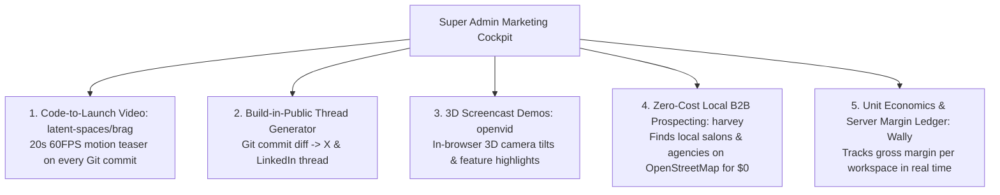
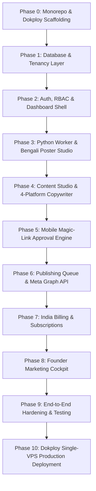

# ABCD Social Hub — Product & Technical Blueprint
**Canonical Architecture, System Design & Implementation Roadmap**

* **Version:** 2.0 (Production Blueprint)
* **Date:** 20 October 2026
* **Target Environment:** Single Low-Cost VPS (Hetzner / Contabo) orchestrated via **Dokploy**
* **Deployment Pattern:** Single Git Repository (Monorepo), 1-Click Automated Deployment
* **Parent Brand:** ABCD Digital Hub

---

## Table of Contents

1. [Executive Summary & Core Differentiators (The Wedge)](#1-executive-summary--core-differentiators-the-wedge)
2. [Market Opportunity, Niche & Positioning](#2-market-opportunity-niche--positioning)
3. [Product Scope & MVP Capabilities](#3-product-scope--mvp-capabilities)
4. [Indian Pricing, Packaging & Unit Economics](#4-indian-pricing-packaging--unit-economics)
5. [Technical Architecture: Single-VPS Monorepo (Dokploy)](#5-technical-architecture-single-vps-monorepo-dokploy)
6. [Founder Marketing & Dogfooding Cockpit (`/admin/marketing`)](#6-founder-marketing--dogfooding-cockpit-adminmarketing)
7. [AI, Copywriting Multiplexer & Media Pipelines](#7-ai-copywriting-multiplexer--media-pipelines)
8. [Multi-Tenant Database Design & Security](#8-multi-tenant-database-design--security)
9. [Platform Integrations & Policy Realities](#9-platform-integrations--policy-realities)
10. [Role-Based Dashboard Specification](#10-role-based-dashboard-specification)
11. [Step-by-Step Implementation Roadmap (Phases 0–10)](#11-step-by-step-implementation-roadmap-phases-010)
12. [Master Credentials & Environment Checklist](#12-master-credentials--environment-checklist)

---

## 1. Executive Summary & Core Differentiators (The Wedge)

**ABCD Social Hub** is a multi-tenant marketing-automation SaaS engineered specifically for **Indian local service businesses** (salons, clinics, fitness centers, tutors, repair centers, real estate agents) and creator-led brands.

### The Problem It Solves
Small business owners know they need an active presence on Instagram, Facebook, and WhatsApp, but:
1. They cannot afford ₹15,000–₹30,000/month digital marketing agencies.
2. They do not know graphic design, and Canva is too time-consuming.
3. They live on their smartphones and will **never** log into a complicated desktop dashboard every day.
4. Generic AI tools produce robotic English "slop" and break native Bengali/Indic typography with detached vowel marks (*যুক্তাক্ষর*).

### The 4 Killer Capabilities (The Launch Wedge)
1. **Branded Regional Poster Studio (Bengali & English):** Turns raw promo briefs (e.g., *"50% off hair spa for Durga Puja"*) into 1080×1080 social posters with the business logo, contact number, and address footer. Satori + GNU Cairo rendering guarantees unbreakable font ligatures.
2. **Mobile Magic-Link Approval (Zero-Login Phone UX):** Business owners receive a secure, token-hashed magic link via WhatsApp/Email. They tap **"Approve"** or **"Request Changes"** directly on their phone in 5 seconds—zero password friction.
3. **4-Platform Copywriting Multiplexer with Anti-AI Slop Humanizer:** Generates tailored copy for Instagram, Facebook, LinkedIn, and X using proven hook/retention frameworks (`Jakeschincariol` agent skills), filtered through `Turnitout-Humanizer` to purge AI buzzwords (*"delve"*, *"testament"*, *"tapestry"*).
4. **Founder Marketing & Dogfooding Cockpit (`/admin/marketing`):** Private suite allowing the founder to market ABCD Social Hub while building it:
   - `latent-spaces/brag`: 20s 60FPS motion teaser videos on Git commits.
   - `CristianOlivera1/openvid`: In-browser 3D screencast demos with $0 cloud cost.
   - `ethanplusai/harvey`: Zero-cost local B2B prospecting to get the first 50 paying clients.
   - `polius/Wally`: Live unit economics and server margin ledger.

---

## 2. Market Opportunity, Niche & Positioning

### Recommended Launch Niche
**Local service businesses and small marketing agencies in West Bengal** (salons, clinics, educational coaching, repair businesses). Founder-led onboarding and native Bengali/English quality create an immediate, defensible local moat.

### One-Sentence Positioning
> "ABCD Social Hub helps Indian businesses turn their offers and ideas into approved, branded Bengali & English social content—published automatically with 1-tap phone approvals."

### Customer Priority Matrix

| Customer Segment | Core Pain Point | Willingness to Pay | Launch Priority |
|---|---|---|---|
| **Local Service Businesses** | Inconsistent posts, lost leads, Canva frustration | ₹999 – ₹1,499/mo | **High (Primary Wedge)** |
| **Small Agencies (5–30 clients)** | Repetitive writing, approval chasing, reporting | ₹2,499 – ₹7,999/mo | **High (Revenue Multiplier)** |
| **Creators / Educators** | Repurposing ideas across 4 networks | ₹999 – ₹1,999/mo | **Phase 5 (Secondary)** |
| **Enterprises / Franchises** | Complex approval hierarchies, governance | ₹25,000+/mo | **Deferred** |

---

## 3. Product Scope & MVP Capabilities

### MVP User Journey
```text
1. Onboard Business ──► 2. Input Promo Brief ──► 3. AI Studio & Poster Generator
   (Name, Logo, Phone,     ("50% off Puja sale")     (Bengali/English 1080x1080 poster +
    Address, Colors)                                  Turnitout 4-channel copy)
                                                                 │
                                                                 ▼
6. Scheduled Publication ◄── 5. One-Tap Approval ◄── 4. Mobile Magic Link
   (Meta Graph API: FB Page    (Business owner taps       (Sent via WhatsApp /
    & IG Professional)          "Approve" on phone)        Email, zero login)
```

### Feature Scope Matrix

| Feature | MVP Status | Technical Implementation |
|---|---|---|
| **Brand Profile & Tone Kit** | **Yes** | Prisma `BrandKit` model (Logo, colors, phone, address, forbidden words) |
| **Branded Poster Studio (1080×1080)** | **Yes** | Python Cairo/Pango worker + Satori template generator |
| **Mobile Magic-Link Approval** | **Yes** | SHA-256 hashed token route `/approve/[token]` (Mobile-optimized) |
| **4-Platform Copywriter** | **Yes** | Jakeschincariol prompt structures + Turnitout anti-slop scrubber |
| **Meta Publishing (FB & IG)** | **Yes** | Official Meta Graph API with 2-step Instagram container flow |
| **Media Normalizer (240+ formats)** | **Yes** | `KnifeLemon/Filee` + FFmpeg (Converts HEIC/MOV to WebP/MP4) |
| **Short-Video Generator** | **Beta Add-on** | `MoneyPrinterTurbo` (Edge-TTS voiceover + Whisper auto-subtitles) |
| **Sovereign P2P Asset Drops** | **Yes** | `polius/FileSync` for direct desktop $\rightarrow$ VPS transfers |
| **WhatsApp Click-to-Chat Leads** | **Yes** | Direct `https://wa.me/` links with pre-filled enquiry text |
| **WhatsApp Cloud API Inbox** | **Phase 2** | Gated behind Meta Tech Provider verification |
| **Customer Workflow Builder** | **Deferred** | Replaces n8n with deterministic internal rules |

---

## 4. Indian Pricing, Packaging & Unit Economics

### Plan Structure (All Prices in INR ₹)

| Feature | Starter (₹999/mo) | Growth Business (₹1,499/mo) | Agency (₹2,499/mo) |
|---|---|---|---|
| **Target** | Solo shop, tutor, clinic | Active salon, gym, restaurant | Local digital consultant |
| **Workspaces / Brands** | 1 Brand | 2 Brands | 5 Client Workspaces |
| **Branded Posters / mo** | 20 Posters | 50 Posters | 150 Posters |
| **Channels Supported** | Facebook & Instagram | FB, IG, LinkedIn, X | All Channels |
| **Mobile Magic Approvals** | Included | Included | Included (Per client) |
| **Copywriter Multiplexer** | Included | Included + Turnitout | Included + Bulk Export |
| **WhatsApp Leads** | Click-to-chat link | Click-to-chat + List | Custom Lead CRM |
| **Video Shorts (9:16)** | Optional Add-on | 5 Video Shorts / mo | 20 Video Shorts / mo |

### Unit Economics per Account (Growth Tier @ ₹1,499/mo)
* **Collected Revenue (Excl. GST):** ₹1,499
* **Payment Gateway Fee (Razorpay 2%):** -₹30
* **AI Text Generation (OpenAI / DeepSeek):** -₹45
* **Poster Rendering (Cairo on VPS):** -₹0 (Fixed VPS cost)
* **Cloudflare R2 Storage & CDN:** -₹15
* **Transactional Email (Resend):** -₹10
* **Net Gross Margin:** **₹1,399 (93.3% Gross Margin)**

---

## 5. Technical Architecture: Single-VPS Monorepo (Dokploy)

### 5.1 Stack Overview
The entire application runs on **one single Virtual Machine** (Hetzner CPX31 for ~€12/mo or Contabo VPS 2 for ~$10/mo) managed via **Dokploy**:

```text
abcd-social-hub/
├── docker-compose.yml              # Dokploy deployment definition
├── .env.example
├── apps/
│   ├── web/                        # Next.js 15/16 App Router (Full-Stack UI & APIs)
│   └── python-worker/              # Python 3.11+ FastAPI (Heavy Media & Poster Engine)
├── packages/
│   ├── db/                         # Prisma Schema, Tenant-Scoped Repository, Migrations
│   └── ui/                         # Design system tokens, glassmorphism components
└── scripts/                        # Automated DB initialization & nightly R2 backups
```

### 5.2 Network Architecture

```mermaid
graph TD
    CLIENT[Mobile Phone / Desktop Browser] -->|Cloudflare DNS + SSL| DOKPLOY[Dokploy Traefik Reverse Proxy]
    
    subgraph Single VPS Node (Dokploy Host: 4-8 vCPU, 8-16GB RAM)
        DOKPLOY -->|Port 3000| NEXT[apps/web: Next.js App Router<br/>• UI & Glassmorphism Dashboard<br/>• Auth, RBAC & Tenant Scoping<br/>• Mobile Magic-Link Approval Pages<br/>• Meta OAuth & Webhook Handlers<br/>• Razorpay Subscription Engine]
        
        NEXT -->|Internal TCP :5432| PG[(PostgreSQL 16 Database<br/>• Tenant Data & Audit Logs<br/>• Usage Ledger & Credits<br/>• pg-boss Queue Tables)]
        
        NEXT -->|Internal HTTP :8000| PY[apps/python-worker: FastAPI<br/>• Satori / Cairo Bengali Poster Studio<br/>• MoneyPrinterTurbo Short-Video Engine<br/>• Turnitout Anti-Slop Humanizer<br/>• Filee 240+ Asset Ingest Normalizer]
        
        PY -->|Claim Jobs & Write Status| PG
        PY -->|Upload Rendered Media| CLOUD[Cloudinary / Cloudflare R2<br/>Signed CDN Delivery]
    end
    
    NEXT -->|Official Graph API| META[Meta Graph API<br/>Facebook & Instagram Publishing]
    NEXT -->|Webhooks & UPI Autopay| RAZOR[Razorpay / YouPI Gateway]
```

---

## 6. Founder Marketing & Dogfooding Cockpit (`/admin/marketing`)

A solo founder cannot pause development for hours to create marketing content. The Super Admin console includes a private marketing engine:



1. **1-Click Code-to-Launch Videos (`latent-spaces/brag`):** Takes recent Git commit messages and renders a 20-second 60FPS motion video with sound effects for social media announcements.
2. **"Build-in-Public" Thread Writer:** Formats code changelogs into engaging founder stories for LinkedIn and X using `Jakeschincariol` skill structures.
3. **In-Browser 3D Demos (`CristianOlivera1/openvid`):** Captures high-res product screencasts with 3D camera tilts with zero server rendering costs.
4. **Autonomous Local B2B Prospecting (`ethanplusai/harvey`):** Discovers local businesses (salons, clinics, gyms) on OpenStreetMap with $0 API overhead and drafts personalized cold email sequences to acquire the first 50 pilot clients.
5. **Unit Economics & Margin Ledger (`polius/Wally`):** Real-time ledger displaying Gross Contribution per customer, alerting before any account's compute usage turns unprofitable.

---

## 7. AI, Copywriting Multiplexer & Media Pipelines

### 7.1 The 4-Platform Copywriting Multiplexer
Adapts raw briefs into native channel formats:
* **Instagram:** 3-second visual hook, carousel slide rhythm, 3-tier caption (hook, body, comment CTA), niche hashtag clusters.
* **Facebook:** Community storytelling, relatable local dialect, direct click-to-WhatsApp link.
* **LinkedIn:** Above-the-fold scroll stopper, double-spaced airy readability, professional insight, conversation question.
* **X (Twitter):** 280-character punchline, 5-tweet micro-thread, curiosity gap.

### 7.2 Turnitout-Humanizer Filter
Deterministic regex and syntactic filter that:
* Strips banned AI buzzwords (*"delve"*, *"testament"*, *"tapestry"*, *"beacon"*, *"in today's digital world"*, *"unlock your potential"*).
* Alternates sentence lengths to mimic authentic human writing cadence.
* Automatically anchors text with local business information (store address, landmarks, direct contact).

### 7.3 Heavy Media Pipelines (Python Worker)
1. **Cairo / Satori Bengali Typography Studio:** Bundles GNU Cairo with `Noto Sans Bengali` and `Hind Siliguri` fonts. Renders 1080×1080 branded posters in under 450ms without broken vowel ligatures.
2. **1-Click Short Video Synthesis (`MoneyPrinterTurbo`):** Combines vertical background clips, Edge-TTS ($0 narration), and Whisper word-by-word animated subtitles into 15–30s reels.
3. **240+ Format Media Normalizer (`KnifeLemon/Filee`):** Converts uncompressed client files (Apple HEIC, iPhone MOV, voice notes) into web-optimized H.264 MP4 and WebP before CDN upload.
4. **Sovereign P2P File Sync (`polius/FileSync`):** P2P encrypted direct transfer between founder/agency desktop and VPS storage without HTTP upload timeouts.

---

## 8. Multi-Tenant Database Design & Security

### 8.1 Multi-Tenant Tenancy Model
* Every database query must be scoped by `workspaceId`.
* Direct, un-scoped Prisma queries from API routes or components are strictly forbidden.
* All access is routed through `createTenantRepository(workspaceId)`.

### 8.2 Security & Token Safeguards
* **Social Token Encryption:** Tokens are encrypted with AES-256-GCM before storage. Decryption keys are stored outside the database. Tokens are **never** logged or returned to the browser.
* **Magic-Link Mobile Security:** Mobile approval URLs use cryptographically random SHA-256 hashed tokens with a 72-hour expiration, scoped strictly to a single content item.
* **Audit Logging:** Every privileged action (account connection, plan change, support access, content publication) generates an immutable `AuditLog` entry.

---

## 9. Platform Integrations & Policy Realities

### Meta Graph API (Facebook Pages & Instagram Professional)
* Connects via official Meta OAuth.
* Instagram publishing uses the official **two-step container flow**:
  1. `POST /{ig-user-id}/media` $\rightarrow$ Store returned `container_id` in database.
  2. Poll status until container is ready.
  3. `POST /{ig-user-id}/media_publish?creation_id={container_id}`.
* Bounded exponential backoff with jitter on transient failures; auth failures immediately flag `NEEDS_RECONNECT`.

### Payment Gateways (India-First)
* **Razorpay:** Primary recurring billing engine for UPI Autopay and debit/credit cards. Webhooks verified with SHA-256 signature.
* **YouPI-PG:** Sovereign, zero-fee direct UPI QR code checkout alternative.

---

## 10. Role-Based Dashboard Specification

One shared codebase with role-scoped views and permissions:

1. **Super Admin (`/admin`):**
   * Overview (MRR, active workspaces, AI costs, queue health).
   * Users, Workspaces, and Subscription management.
   * **Founder Marketing Cockpit (`/admin/marketing`)**: `brag`, `openvid`, `harvey`, `Wally`.
   * Diagnostic Sandbox and Audit Logs.
2. **Business Owner (`/dashboard`):**
   * Workspace switcher, Brand Kit (logo, phone, address banner, Bengali/English fonts).
   * Content Studio (AI prompt composer, live poster preview).
   * Monthly Calendar and Publishing Queue.
   * Lead Handoff (WhatsApp click-to-chat list).
   * Subscription and Razorpay billing management.
3. **Staff:**
   * Content Studio drafts and assigned approval tasks (no billing access).
4. **Content Creator:**
   * Personal workspace + client workspaces view.
   * Multi-account content multiplexer and export tools.
5. **Mobile Approver (`/approve/[token]`):**
   * Zero-login mobile page (360px tap-friendly).
   * Full-screen poster preview, caption variants, scheduled time.
   * Single-tap "Approve" or "Request Changes" buttons.
6. **Guest Demo (`/demo`):**
   * Isolated sandbox with fictional data. No real publishing or billing allowed.

---

## 11. Step-by-Step Implementation Roadmap (Phases 0–10)



### Phase 0: Monorepo Foundation & Dokploy Architecture ✅
* Initialize pnpm monorepo (`package.json`, `pnpm-workspace.yaml`, `.gitignore`).
* Create production `docker-compose.yml` configured with Dokploy Traefik labels.
* Establish `docs/PLAN.md` and `Product_Blueprint.md`.

### Phase 1: Database Layer & Tenancy Model (`packages/db`)
* Configure PostgreSQL 16 container with persistent volume.
* Define `schema.prisma` with multi-tenant workspace isolation.
* Implement `createTenantRepository` wrapper enforcing `workspaceId` checks.

### Phase 2: Authentication & Core Dashboard Shell (`apps/web`)
* Next.js 15/16 App Router setup with NextAuth.
* Implement `@abcd/ui` design system with dark-mode glassmorphism tokens.
* Build `AppShell`, `Sidebar`, `Header`, and workspace switcher.
* Implement high-converting marketing landing page (`openhero` styling).

### Phase 3: Python Heavy Media Worker (`apps/python-worker`)
* Build FastAPI service with GNU Cairo, Pango, and FFmpeg Docker image.
* Install `Noto Sans Bengali` and `Hind Siliguri` fonts.
* Implement `tasks/poster_render.py` for 1080×1080 branded poster synthesis.
* Implement `tasks/humanizer.py` with Turnitout anti-slop rules.

### Phase 4: Content Studio & Copywriting Multiplexer
* Multi-model composer: transforms business promo brief into 4-channel copy.
* Integrate `Jakeschincariol` copywriting skills (Instagram, Facebook, LinkedIn, X).
* Implement append-only usage credits ledger (reserve, commit, refund).

### Phase 5: Mobile Magic-Link Approval Engine
* Build `/approve/[token]` route optimized for 360px mobile viewports.
* SHA-256 token verification with 72-hour expiry.
* Instant 1-tap "Approve" / "Request Changes" action with WhatsApp notification webhook.

### Phase 6: pg-boss Publishing Queue & Meta Graph API
* Setup `pg-boss` queue tables inside PostgreSQL (`SKIP LOCKED` claiming).
* Meta Graph API integration for Facebook Pages and Instagram Professional.
* Instagram two-step container flow with idempotency protection.
* Token reconnect wizard with user-friendly error banners.

### Phase 7: India Billing & Subscriptions (Razorpay & YouPI-PG)
* Razorpay Subscriptions integration with UPI Autopay and card billing.
* Webhook signature validation and automated plan tier upgrading.
* YouPI-PG sovereign 0% UPI QR code fallback checkout.

### Phase 8: Founder Marketing & Dogfooding Cockpit (`/admin/marketing`)
* `latent-spaces/brag`: Automated 20s 60FPS commit-to-launch video teaser.
* `CristianOlivera1/openvid`: In-browser 3D screencast tool.
* `ethanplusai/harvey`: Local B2B cold outreach scraper for salons and agencies.
* `polius/Wally`: Live unit economics and gross margin tracker.

### Phase 9: Security Auditing, Performance & Tenancy Testing
* Tenant isolation test suite (User A cannot access User B's posts or tokens).
* Webhook signature forgery tests.
* Rate limiting on login and generation endpoints.
* UI 4-state verification (loading skeleton, empty state, error with retry, permission-denied).

### Phase 10: Dokploy Production Launch
* Connect GitHub repository to Dokploy Compose service.
* Configure production environment variables and SSL domain routing.
* Automated nightly database backup cron to Cloudflare R2.

---

## 12. Master Credentials & Environment Checklist

To deploy and run the entire platform smoothly, here are all the environment values you will configure (paste into Dokploy once):

| Variable Name | Service | Purpose | Where to Get It |
|---|---|---|---|
| `DATABASE_URL` | PostgreSQL | Database connection string | Automatically set in Dokploy / Docker Compose |
| `NEXTAUTH_SECRET` | Next.js | JWT session encryption | Run `openssl rand -base64 32` |
| `TOKEN_ENCRYPTION_KEY` | Next.js | AES-256 token encryption (32-byte hex) | Run `openssl rand -hex 32` |
| `INTERNAL_API_SECRET` | Web & Python Worker | Secures Next.js $\leftrightarrow$ Python communication | Generate any random 32-character string |
| `OPENAI_API_KEY` | Next.js | GPT-4o / GPT-4o-mini content drafting | [OpenAI Platform](https://platform.openai.com) |
| `CLOUDINARY_CLOUD_NAME` | Media CDN | Image optimization & responsive resizing | [Cloudinary Console](https://cloudinary.com) (Free 25GB) |
| `CLOUDINARY_API_KEY` | Media CDN | Cloudinary upload authorization | Cloudinary Console |
| `CLOUDINARY_API_SECRET` | Media CDN | Cloudinary upload signature | Cloudinary Console |
| `R2_ACCOUNT_ID` | Video Storage | Cloudflare R2 zero-egress video storage | [Cloudflare Dashboard](https://dash.cloudflare.com) |
| `R2_ACCESS_KEY_ID` | Video Storage | S3-compatible R2 access key | Cloudflare R2 Settings |
| `R2_SECRET_ACCESS_KEY` | Video Storage | S3-compatible R2 secret key | Cloudflare R2 Settings |
| `R2_BUCKET_NAME` | Video Storage | Name of your R2 bucket (e.g. `abcd-social-media`) | Cloudflare R2 |
| `RAZORPAY_KEY_ID` | Payments | India UPI Autopay / card subscriptions | [Razorpay Dashboard](https://dashboard.razorpay.com) |
| `RAZORPAY_KEY_SECRET` | Payments | Razorpay API verification | Razorpay Dashboard |
| `RAZORPAY_WEBHOOK_SECRET` | Payments | Validates Razorpay subscription webhooks | Razorpay Webhooks |
| `META_APP_ID` | Social Publishing | Facebook & Instagram Graph API App ID | [Meta for Developers](https://developers.facebook.com) |
| `META_APP_SECRET` | Social Publishing | Meta OAuth token exchange | Meta for Developers |
| `RESEND_API_KEY` | Transactional Email | Magic-link approval emails & billing receipts | [Resend Dashboard](https://resend.com) |

---

*This document is the single source of truth for ABCD Social Hub's system design, technical decisions, and execution roadmap.*
