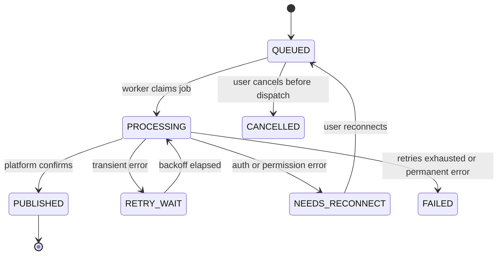

# ABCD Social — Final Product Plan and System Design

**Working name:** ABCD Social (marketing automation for creators and business owners)
**Date:** 20 October 2026
**Inputs analysed:** `gemini_plan.md` (architecture spec), `gpt_plan.md` (corrective decision document), `deepseek_plan.md` (opinion and verdict)
**Status:** Decision document. Not legal, tax, or financial advice. Every item marked **VERIFY** must be checked against the live vendor or platform documentation before you build on it.

---

## 0. Summary in one page

**What you are building:** one platform where a business owner or creator sets up their brand once, gets a month of platform-ready content generated, approves it from their phone, and has it published reliably, with automation rules that remove repetitive work and a WhatsApp handoff so enquiries are not lost.

**The three decisions that shape everything:**

1. **One engine, two modes, one launch customer.** The data model and engine serve both Creator and Business workspaces from day one. The launch experience targets one customer type: local service businesses and small agencies in West Bengal. Creator mode ships second, reusing the same engine with different templates and inputs.
2. **Own the core, rent nothing critical.** Scheduling, publishing state, billing state, credits, and permissions live in your own Next.js and Node worker code with PostgreSQL. No n8n in the product, no Python service, no Redis on day one.
3. **Smallest reliable thing first.** Facebook Page and Instagram Business publishing through official Meta APIs, human approval by default, WhatsApp click-to-chat links, Razorpay billing. WhatsApp Cloud API, comment-to-DM, LinkedIn, YouTube, X, and video transcription are gated behind proven demand and verified API access.

**Stack in one line:** Next.js (App Router, TypeScript) + Node worker + PostgreSQL (Prisma) + Postgres-backed job queue (pg-boss) + object storage + LLM provider abstraction + Razorpay + Resend. All JavaScript/TypeScript, two deployable services.

**Realistic timeline:** about 14–18 weeks of focused work to a paid beta (not 12 weeks to everything). Meta app review runs in parallel and is the critical path, so start it in week 1.

---

## 1. Analysis of the three plans

### 1.1 What each plan is

| Plan | Nature | Main strength | Main weakness |
|---|---|---|---|
| **Gemini** | Ambitious architecture and product spec | Product vision, dual personas, India-specific billing, platform "do not" list, super-admin and sandbox ideas | Four products in one 12-week build; tenant-unsafe schema; n8n at the core; `yt-dlp` pipeline; unvalidated pricing |
| **GPT** | Risk-corrective decision document | Scope discipline, platform policy reality, n8n licence boundary, tenant isolation, unit economics, validation-first | Very long; cautious to the point of a weak differentiator; vague on what replaces n8n and Redis |
| **DeepSeek** | Opinionated verdict on the other two | Sharp calls: single platform, no n8n, DB-backed jobs, WhatsApp as later module, differentiation must be local workflow depth | Narrows to local businesses only, so Creator mode is dropped entirely; some cost assumptions left untested |

### 1.2 Where all three agree (adopted as-is)

- Use official platform APIs only. No scraping, no unofficial WhatsApp libraries (Baileys, Puppeteer).
- AI output is a draft. Human approval is the default before anything is published.
- Content must be adapted per platform, never identical cross-posting.
- No "unlimited" promises. Hard quotas with transparent usage.
- Publishing runs in a separate worker, never inside a web request.
- India-first billing: Razorpay subscriptions, UPI Autopay, GST invoices.
- Encrypted tokens, audit logs, and an admin console with controlled support access.
- The 12-week "everything" plan is unrealistic; validate with paid pilots before building broadly.

### 1.3 Disagreements and how this plan resolves them

| Topic | Gemini | GPT | DeepSeek | **Decision here** |
|---|---|---|---|---|
| Target customer | Creators and businesses equally | One niche, choose among three | Local businesses only | **Engine supports both; launch UX targets local businesses and small agencies; Creator mode in Phase 5** |
| n8n | Core engine | Internal only, licence check | Not in product | **Not in product.** Fixed automation rules run in your own worker. |
| Background jobs | n8n cron + Celery + Redis | Queue + worker, Redis if needed | DB-backed jobs, no Redis | **pg-boss (Postgres-backed queue) in a Node worker.** Add Redis only when measured need appears. |
| Python / FastAPI | Day one | Only when media justifies it | Only when transcription is paid for | **No Python.** Stay in TypeScript. Use API-based transcription later. |
| `yt-dlp` YouTube download | Core of Repurposer | Needs rights review | Reject | **Rejected.** Upload-only or user-owned text/audio. |
| WhatsApp | Native Cloud API in mid-tier | Separate controlled module | Later, separately priced; click-to-chat first | **Click-to-chat in MVP. Cloud API after gates (Section 8).** |
| LinkedIn | Launch channel | High uncertainty | Apply for Development tier, treat as possible second | **Not at launch. Apply early in background; ship only after access is confirmed.** |
| Super-admin impersonation | One click | Audited, time-limited | Customer-visible, time-limited | **Time-limited, reason-logged, customer-visible support sessions.** |
| Pricing | ₹999 to ₹24,999 | ₹799–₹7,999 plus setup | Do not publish tiers you cannot deliver | **Three SaaS tiers plus a setup fee, as hypotheses to test.** |
| Differentiator | Breadth | Trust, onboarding, India workflow | Local workflow depth + WhatsApp handoff + done-with-you onboarding | **DeepSeek's three-part differentiator, plus the poster studio (Section 1.4).** |

### 1.4 Gaps that none of the three plans fill

1. **"Automation" is never defined for the MVP.** Gemini delegates it to n8n; GPT and DeepSeek mostly remove it. A product called marketing automation needs a concrete, shippable automation set. Section 2.4 defines one that runs in your own worker.
2. **Instagram needs media.** Instagram publishing requires an image or video. Local businesses rarely have designed creatives. A text-only generator therefore fails at the exact moment of publishing. The plan adds a template-based **poster studio** (festival, offer, service, announcement) rendered server-side from the brand kit. This is cheap, deterministic, and a real differentiator. **Test Bengali text rendering first** (complex-script shaping can be unreliable in some image renderers); keep a headless-browser rendering fallback.
3. **Owners live on their phones, not in dashboards.** Approval should work through a **magic link opened on mobile, with no login**, delivered by email first and WhatsApp utility message later. This is what makes "human approval" practical instead of a blocker.
4. **Meta app review is the schedule's critical path** and none of the plans sequences it. Business verification, privacy policy, data-deletion callback, screencast evidence, and review rounds can take longer than coding. Start in week 1.
5. **Database choice interacts with the queue.** A Postgres-backed worker polls continuously. On a scale-to-zero serverless database it keeps compute awake (cost) and pooled connections can break queue locking. Use a database plan that does not sleep, and give the worker a direct (non-pooled) connection.
6. **Publish idempotency for Instagram's two-step flow** (create media container, then publish) is not described. Store the container ID before publishing so a retry resumes instead of creating a duplicate.

---

## 2. Product definition

### 2.1 Positioning

> ABCD Social helps small businesses and creators turn their brand information and ideas into a month of platform-ready posts, get them approved from a phone, and publish them reliably, with automation rules and a WhatsApp handoff so no enquiry is lost.

**What it is not (at launch):** a unified inbox, a CRM, an ad manager, a social listening tool, a video editor, or a workflow builder.

### 2.2 Customers

| Priority | Segment | Why |
|---|---|---|
| **Launch** | Local service businesses (salons, gyms, tuition centres, clinics, repair and home services) in West Bengal with a Facebook Page, Instagram Business account, and WhatsApp for enquiries | Reachable through direct outreach and local language; clear pain (irregular posting, lost leads); you can onboard personally |
| **Launch (multiplier)** | Small agencies managing 5–30 such businesses | One agency brings many workspaces; needs approvals and multi-brand view |
| **Phase 5** | Creators, coaches, educators | Same engine; adds repurposing of owned text/audio and creator templates |
| **Not now** | Enterprises, franchises, D2C brands needing inbox, attribution, LinkedIn, X | Different product and sales cycle |

### 2.3 Core loop

```
Brand setup  →  Plan (monthly ideas)  →  Create (drafts + poster)  →  Approve (phone link)
      ↑                                                                      ↓
   Report  ←  Handoff (WhatsApp click-to-chat)  ←  Publish (official API, per destination)
```

### 2.4 What "automation" means in the MVP

All of these run inside your own worker as fixed, tested rule types. Customers toggle and configure them; they do not build arbitrary workflows.

| Automation | Trigger | Action |
|---|---|---|
| **Monthly plan generation** | First of month (or on request) | Generate 10–20 ideas and drafts from the brand profile, festival calendar, and active offers |
| **Festival and occasion suggestions** | Date proximity to a festival in the regional calendar | Create a draft with a poster for approval |
| **Approval reminders** | Draft awaiting approval for N hours | Email nudge with the magic link |
| **Auto-schedule on approval** | Owner approves | Place in the next best slot per the workspace's posting schedule |
| **Failure recovery** | Publish error | Bounded retry with backoff; on permission error, stop and ask to reconnect |
| **Token health watchdog** | Token expiring within 7 days | Warn owner and offer one-click reconnect |
| **Evergreen recycle queue** | Gap in calendar | Propose re-using top past posts, adapted, for approval |
| **WhatsApp handoff link** | Post created with a CTA | Append a `wa.me` link with a prefilled message tagged per post |
| **Weekly summary** | Weekly | Email: posts published, failures, credits used, clicks on tracked links |

Everything above defaults to **approval-required**. A narrowly scoped "auto-publish approved templates" setting can come after trust is established.

### 2.5 Creator mode versus Business mode

Same tables, same engine, same publishing path. Differences are configuration:

| Dimension | Business mode | Creator mode (Phase 5) |
|---|---|---|
| Brand profile fields | Services, offers, location, hours, forbidden claims | Niche, audience, signature topics, voice samples |
| Templates | Festival, offer, service, FAQ, testimonial request | Hook, carousel, thread, long-to-short |
| Source input | Offers and facts typed by owner | Own text, notes, uploaded audio/video |
| Default dashboard | Posts, approvals, link clicks | Posts, repurposed assets, credits |
| Approvals | Owner (and one editor) | Self-approval allowed |

### 2.6 Feature scope by phase

| Feature | MVP (paid beta) | V2 | V3 | Notes |
|---|---|---|---|---|
| Org, workspace, roles (owner, editor, viewer) | ✅ | | | Multi-step approval chains later |
| Brand profile and brand kit (logo, colours, fonts) | ✅ | | | Grounding data for AI and posters |
| AI ideas and platform-specific drafts (FB, IG) | ✅ | | | Text via provider abstraction |
| English + Bengali | ✅ if quality passes test | More languages | | Test with 20 real briefs first |
| Poster studio (template-based images) | ✅ | AI images (credit-limited) | | Deterministic, low cost |
| Calendar, drafts, edit, preview | ✅ | | | |
| Magic-link mobile approval | ✅ | | | |
| Facebook Page + Instagram Business publishing | ✅ | | | One Meta app |
| Per-destination status, retry, plain-language errors | ✅ | | | |
| Automation rules (Section 2.4) | ✅ | More rule types | | |
| WhatsApp click-to-chat with tagged links | ✅ | | | No API permission needed |
| Usage dashboard and credits | ✅ | | | |
| Razorpay subscription + GST invoice | ✅ | | | |
| Admin console (metrics, tenant search, support sessions) | Minimal | Full | | |
| Creator mode and repurposer (owned text/audio upload) | | ✅ | | |
| Basic analytics where API allows | | ✅ | | |
| Agency multi-brand view, client approval | | ✅ | | |
| WhatsApp Cloud API messaging | | | ✅ gated | Opt-in, templates, cost pass-through |
| Comment-to-DM | | | ✅ gated | Only if Meta permissions granted |
| LinkedIn, YouTube, Google Business, X | | | ✅ one at a time | Each is its own project |
| Unified inbox, full CRM, attribution | | | Separate product | |
| Customer-built workflow builder | Never | | | Unless a commercial workflow-engine licence is obtained |

### 2.7 Product rules

- Every AI asset is a draft until a human approves it.
- Never invent prices, discounts, addresses, hours, guarantees, medical or legal claims, or testimonials. If a fact is missing, ask for it.
- Show account, destination, time (IST), media, and final text before approval.
- A retry must never produce a duplicate post.
- A global pause switch stops all scheduled publishing, per workspace and platform-wide.
- Customers can export their content and delete their data.

---

## 3. System design

### 3.1 Design principles

1. **Two deployable services** (web, worker) plus managed Postgres and object storage. Every extra service must justify itself with a measured bottleneck.
2. **Postgres is the source of truth** for tenants, content, jobs, credits, subscriptions, and audit.
3. **Deterministic code decides, the model only drafts.** AI never approves, publishes, bills, or grants access.
4. **Per-destination everything.** Each platform destination has its own variant, job, status, and error.
5. **Idempotent by construction.** Jobs, webhooks, and billing events carry unique keys.
6. **Fail visibly and recover safely.** Every failure has a plain-language reason and a next action.

### 3.2 Architecture

```
                      Customer browser / phone
                               │
                  Cloudflare (DNS, WAF, CDN)
                               │
                ┌──────────────▼───────────────┐
                │  WEB  — Next.js (TypeScript) │
                │  • UI (App Router)           │
                │  • API routes / Server Actions│
                │  • Auth, authz, tenant scope │
                │  • OAuth callbacks           │
                │  • Webhook endpoints         │
                │    (Razorpay, Meta)          │
                │  • Magic-link approval pages │
                └───────┬───────────────┬──────┘
                        │ enqueue       │ read/write
                        ▼               ▼
              ┌───────────────────────────────┐
              │  PostgreSQL (managed)         │
              │  tenants · content · jobs ·   │
              │  ledger · billing · audit     │
              │  pg-boss queue tables         │
              └───────▲───────────────┬───────┘
                      │ claim (SKIP LOCKED)
                ┌─────┴───────────────▼──────┐
                │  WORKER — Node/TypeScript   │
                │  • Publish jobs             │
                │  • AI generation jobs       │
                │  • Poster render jobs       │
                │  • Automation scheduler     │
                │  • Token watchdog           │
                │  • Email dispatch           │
                └───┬────────┬────────┬───────┘
                    │        │        │
              Meta Graph   LLM      Object storage
                 API     providers  (R2 / S3 / Cloudinary)
                                    Resend (email)
```

### 3.3 Technology choices

| Layer | Choice | Reason |
|---|---|---|
| Web and API | Next.js App Router, TypeScript | One codebase; typed platform payloads reduce publishing bugs |
| UI | Tailwind + shadcn/ui | Fast, consistent dashboard building |
| Database | Managed PostgreSQL on a plan that does not scale to zero | The worker polls; sleeping compute and pooled connections cause trouble |
| ORM | Prisma (raw SQL where needed) | Typed client and migrations; raw SQL for queue-adjacent queries |
| Queue | **pg-boss** in the worker, using a **direct (non-pooled)** connection | Postgres-backed, uses `SKIP LOCKED`, retries and scheduling built in, no Redis. **VERIFY** current version and connection requirements |
| Auth | Auth.js or Better Auth with email magic link + Google; do not hand-roll | Organization support, secure sessions |
| AI | Thin provider interface (own wrapper, optionally Vercel AI SDK) | Route cheap model for captions, stronger for planning; log cost per call |
| Poster rendering | Server-side HTML/SVG → PNG in the worker (satori + resvg, or headless browser fallback) | Deterministic branded images; **test Bengali early** |
| Media | Object storage (Cloudflare R2 / S3) with signed URLs; Cloudinary optional | Lifecycle rules; private by default |
| Email | Resend | Alerts, magic links, summaries |
| Payments | Razorpay Subscriptions with UPI Autopay | India-first; webhook-driven state |
| Monitoring | Sentry + uptime check + structured logs (pino) | Know about failures before customers do |
| Hosting | Dokploy on an Ubuntu VPS **or** a managed container host; web and worker as separate containers; Postgres managed and separate | A single VPS running everything is a single point of failure |

### 3.4 Repository layout

```
abcd-social/
├── apps/
│   ├── web/                  # Next.js app
│   │   ├── app/(marketing)/  # landing, pricing
│   │   ├── app/(app)/        # authenticated product
│   │   ├── app/approve/[token]/   # magic-link approval (no login)
│   │   ├── app/api/webhooks/{razorpay,meta}/
│   │   └── app/admin/        # super-admin (separate guard + MFA)
│   └── worker/               # Node worker (pg-boss)
│       ├── jobs/{publish,generate,poster,automation,watchdog,email}.ts
│       └── index.ts
├── packages/
│   ├── db/                   # Prisma schema, tenant-scoped repository layer
│   ├── core/                 # domain logic: state machines, credits, rules
│   ├── integrations/         # meta/, razorpay/, whatsapp-links/, (later: linkedin/, youtube/)
│   ├── ai/                   # provider interface, prompts, schemas (zod), evals
│   ├── poster/               # templates, brand-kit renderer
│   └── config/               # env validation, plan limits
└── docs/                     # runbooks, capability matrix, legal checklists
```

All database access from web and worker goes through `packages/db`'s **tenant-scoped repository**; raw `prisma.model.findUnique({ id })` without a workspace is banned by lint rule and code review.

### 3.5 Data model

Core rules: every tenant-owned row has `workspaceId` (and `orgId` where relevant) **directly**, never reachable only through a join. The usage ledger is append-only. Tokens are stored encrypted.

```prisma
enum Role            { OWNER EDITOR VIEWER }
enum WorkspaceMode   { BUSINESS CREATOR }
enum Platform        { FACEBOOK_PAGE INSTAGRAM_BUSINESS }   // extend one at a time
enum ContentStatus   { DRAFT IN_REVIEW APPROVED SCHEDULED CANCELLED }
enum JobStatus       { QUEUED PROCESSING RETRY_WAIT PUBLISHED FAILED NEEDS_RECONNECT CANCELLED }
enum SubStatus       { INCOMPLETE ACTIVE PAST_DUE HALTED CANCELLED }

model Organization {
  id String @id @default(uuid())
  name String
  slug String @unique
  billingEmail String
  gstin String?
  createdAt DateTime @default(now())
  memberships Membership[]
  workspaces  Workspace[]
  subscription Subscription?
}

model User {
  id String @id @default(uuid())
  email String @unique
  name String?
  phone String?
  isSuperAdmin Boolean @default(false)
  createdAt DateTime @default(now())
  memberships Membership[]
}

model Membership {
  id String @id @default(uuid())
  userId String
  orgId String
  role Role
  @@unique([userId, orgId])
}

model Workspace {
  id String @id @default(uuid())
  orgId String
  name String
  mode WorkspaceMode @default(BUSINESS)
  timezone String @default("Asia/Kolkata")
  language String @default("en")        // en | bn | mixed
  brandProfile Json                      // services, offers, tone, forbidden claims, facts
  brandKit Json?                         // logo url, colours, fonts
  waNumber String?                       // for click-to-chat links
  publishingPaused Boolean @default(false)
  @@index([orgId])
}

model SocialConnection {
  id String @id @default(uuid())
  workspaceId String
  platform Platform
  platformAccountId String
  accountName String
  encAccessToken Bytes                   // authenticated encryption; key outside DB
  encRefreshToken Bytes?
  tokenExpiresAt DateTime?
  scopes String[]
  isActive Boolean @default(true)
  needsReconnect Boolean @default(false)
  @@unique([workspaceId, platform, platformAccountId])
  @@index([workspaceId])
}

model ContentItem {
  id String @id @default(uuid())
  workspaceId String
  title String?
  idea String?                           // source idea / brief
  status ContentStatus @default(DRAFT)
  createdById String?
  approvedById String?
  approvedAt DateTime?
  createdAt DateTime @default(now())
  @@index([workspaceId, status])
}

model ContentVariant {                   // one per destination platform
  id String @id @default(uuid())
  workspaceId String
  contentItemId String
  platform Platform
  body String
  hashtags String[]
  mediaAssetIds String[]
  cta Json?                              // type, wa link id
  revision Int @default(1)
  @@index([contentItemId, platform])
  @@index([workspaceId])
}

model MediaAsset {
  id String @id @default(uuid())
  workspaceId String
  kind String                            // POSTER | UPLOAD | AI_IMAGE
  storageKey String
  width Int?
  height Int?
  mimeType String
  createdAt DateTime @default(now())
  @@index([workspaceId])
}

model PublishJob {                       // one per variant × connection × time
  id String @id @default(uuid())
  workspaceId String
  variantId String
  connectionId String
  scheduledFor DateTime
  status JobStatus @default(QUEUED)
  idempotencyKey String @unique          // hash(variantId, connectionId, revision)
  platformContainerId String?            // IG container, saved before publish
  platformPostId String?
  attemptCount Int @default(0)
  lastErrorCode String?
  lastErrorMessage String?               // safe, no secrets
  publishedAt DateTime?
  @@index([status, scheduledFor])
  @@index([workspaceId, status])
}

model PublishAttempt {
  id String @id @default(uuid())
  jobId String
  workspaceId String
  attemptNumber Int
  startedAt DateTime
  finishedAt DateTime?
  httpStatus Int?
  errorCode String?
  requestId String?
  @@index([jobId])
}

model TrackedLink {                      // WhatsApp click-to-chat handoff
  id String @id @default(uuid())
  workspaceId String
  contentItemId String?
  shortCode String @unique
  targetUrl String                       // wa.me/<number>?text=<prefill>
  clickCount Int @default(0)
  createdAt DateTime @default(now())
  @@index([workspaceId])
}

model AutomationRule {
  id String @id @default(uuid())
  workspaceId String
  type String                            // MONTHLY_PLAN | FESTIVAL | APPROVAL_REMINDER | ...
  config Json
  enabled Boolean @default(true)
  lastRunAt DateTime?
  @@index([workspaceId, type])
}

model UsageLedgerEntry {                 // append-only: never update or delete
  id String @id @default(uuid())
  orgId String
  workspaceId String
  kind String                            // GRANT | RESERVE | COMMIT | REFUND | TOPUP
  action String?                         // TEXT_GEN | POSTER | AI_IMAGE | TRANSCRIBE
  credits Int                            // signed
  provider String?
  model String?
  estCostPaise Int?
  refId String?                          // job / generation id
  createdAt DateTime @default(now())
  @@index([orgId, createdAt])
}

model Subscription {
  id String @id @default(uuid())
  orgId String @unique
  razorpaySubId String @unique
  planId String
  status SubStatus
  currentPeriodStart DateTime
  currentPeriodEnd DateTime
}

model WebhookEvent {
  id String @id @default(uuid())
  source String                          // razorpay | meta
  externalId String
  eventType String
  payload Json
  processedAt DateTime?
  createdAt DateTime @default(now())
  @@unique([source, externalId])
}

model ApprovalToken {
  id String @id @default(uuid())
  workspaceId String
  contentItemId String
  tokenHash String @unique               // store hash, not token
  expiresAt DateTime
  usedAt DateTime?
}

model SupportSession {                   // customer-visible, time-limited access
  id String @id @default(uuid())
  orgId String
  adminUserId String
  reason String
  grantedByUserId String?                // customer approval
  startsAt DateTime
  expiresAt DateTime
}

model AuditLog {
  id String @id @default(uuid())
  orgId String?
  workspaceId String?
  actorUserId String?
  action String
  targetType String?
  targetId String?
  metadata Json?
  ipAddress String?
  createdAt DateTime @default(now())
  @@index([orgId, createdAt])
}
```

Later additions (not MVP): `Lead`, `WhatsAppTemplate`, `WhatsAppMessage`, `InboxThread`, `FeatureFlag`.

### 3.6 Multi-tenancy and authorization

- Every request resolves `(user, org, workspace, role)` on the server. A client-supplied `orgId` or `workspaceId` is never trusted without a membership check.
- The `packages/db` repository takes a `TenantContext` and injects `workspaceId` into every query. Worker jobs carry `workspaceId` in the payload and re-verify it against the row they load.
- Defence in depth: add PostgreSQL row-level security once the app is stable and you can test it, not before.
- Super-admin is a separate guard, requires MFA, and cannot read tenant tokens or secrets under any role.
- **Mandatory tests before paid launch:** user A cannot read or modify user B's content, media, connections, invoices, or jobs; a forged `workspaceId` fails; a magic link works only for its own content item.

### 3.7 Content and AI pipeline

```
Brand profile (structured)  ┐
Active offers + dates       ├─► Planner ─► N ideas ─► Drafter ─► Variants per platform
Regional festival calendar  ┘                                     │
                                                                  ▼
                                     Validator (zod schema + fact checks)
                                                                  │
                                                                  ▼
                                  Poster renderer (brand kit + template)
                                                                  │
                                                                  ▼
                                            DRAFT → human review
```

- **Brand profile is structured data**, not a free-text prompt: services, price list (optional), offers with start/end dates, location, hours, tone, language, forbidden claims, contact details.
- **Grounding rule in the prompt:** use only provided facts; if a needed fact is missing, return a `missing_facts` list instead of inventing it. The validator rejects drafts that contain prices, dates, or phone numbers not present in the brand profile.
- **Structured output** validated with zod. Invalid output is retried once, then surfaced as an error without charging credits.
- **Per-platform mutation:** length, hashtag count, line breaks, CTA placement, and tone differ for Facebook versus Instagram.
- **Untrusted input:** uploaded documents, pasted competitor text, and web content are treated as data. They never reach a tool or change system instructions, and the model has no tools that publish, bill, or alter permissions.
- **Evaluation set:** keep 20+ real briefs (English and Bengali) with expected properties; run on every prompt or model change. Track acceptance rate, edit distance, regeneration rate.
- **Model routing:** cheap model for caption variants, stronger for monthly planning. Log provider, model, tokens, and estimated cost per call into the ledger.

### 3.8 Publishing engine

**States**



`ContentItem` has its own status (DRAFT, IN_REVIEW, APPROVED, SCHEDULED, CANCELLED). The user-facing summary ("Published", "Partially published", "Failed") is **derived** from its jobs, so partial success is never hidden behind one global status.

**Worker flow (per job)**

```ts
// apps/worker/jobs/publish.ts  (sketch)
export async function handlePublish(job: { jobId: string; workspaceId: string }) {
  const j = await repo.publishJob.getForWorker(job.jobId, job.workspaceId); // re-verifies tenant
  if (j.status === 'PUBLISHED' || j.status === 'CANCELLED') return;          // idempotent no-op

  const ws = await repo.workspace.get(j.workspaceId);
  if (platformPaused() || ws.publishingPaused) return reschedule(j);

  const conn = await repo.connection.getDecrypted(j.connectionId, j.workspaceId);
  if (conn.needsReconnect || tokenExpired(conn)) return markNeedsReconnect(j);

  await repo.publishJob.markProcessing(j.id);                // increments attemptCount
  const attempt = await repo.attempt.start(j.id);

  try {
    const variant = await repo.variant.get(j.variantId, j.workspaceId);
    const result = await meta.publish({ conn, variant, resume: j.platformContainerId });
    //  Instagram: create container -> SAVE container id -> poll status -> media_publish
    await repo.publishJob.markPublished(j.id, result.platformPostId);
    await audit.log('POST_PUBLISHED', j);
  } catch (err) {
    const c = classify(err);                                   // TRANSIENT | AUTH | PERMANENT | RATE_LIMIT
    await repo.attempt.finish(attempt.id, c);
    if (c.kind === 'AUTH')       return markNeedsReconnect(j, c);   // no retry storm
    if (c.kind === 'PERMANENT')  return markFailed(j, c);
    if (j.attemptCount >= MAX_ATTEMPTS) return markFailed(j, c);
    return retryWithBackoff(j, c.retryAfter);                  // exponential + jitter, honour Retry-After
  }
}
```

**Reliability rules**

- `idempotencyKey = hash(variantId, connectionId, variant.revision)`. A unique constraint stops duplicate jobs.
- pg-boss claims jobs with `SKIP LOCKED`; a job is processed by one worker only.
- For Instagram, **persist the container ID before calling publish**. On retry, resume from the stored container (containers expire, so create them close to publish time; **VERIFY** current expiry and limits).
- Content is editable until a lock window (for example 10 minutes) before dispatch; an edit bumps `revision` and re-keys the job.
- Respect `Retry-After`; do not retry permanent errors; dead-letter after the final attempt and alert the owner via email.
- Store UTC; display IST (and the workspace timezone).
- **Own the scheduler.** Do not rely on platform-side scheduled publishing, so behaviour is uniform and recoverable. **VERIFY** per platform.

### 3.9 Automation rule engine

- A single recurring pg-boss schedule ticks every minute and enqueues due rules (`MONTHLY_PLAN`, `FESTIVAL`, `APPROVAL_REMINDER`, `RECYCLE`, `WEEKLY_SUMMARY`, `TOKEN_WATCHDOG`).
- Each rule type is a TypeScript handler with a zod-validated `config`. New rule types ship as code, with tests.
- Each run writes an audit entry, checks credits before running AI steps, and respects `publishingPaused`.
- No customer-defined arbitrary logic. This keeps the product simple, testable, and clear of workflow-engine licensing questions.

### 3.10 Integrations and capability matrix

**MVP integration: Meta (Facebook Pages and Instagram professional accounts) through one Meta app.**

Before coding each integration, fill this matrix and keep it in `docs/capability-matrix.md`:

| Question | Facebook Page | Instagram Business | (future platform) |
|---|---|---|---|
| Supported account types | | | |
| OAuth scopes / permissions | | | |
| Needs app review / business verification? | | | |
| Supported post types (image, carousel, reel, text) | | | |
| Media size, ratio, duration limits | | | |
| Publishing and rate limits | | | |
| Token lifetime and refresh rules | | | |
| Comment/DM access rules | | | |
| Analytics access | | | |
| Required policy pages (privacy, data deletion) | | | |

Only advertise a capability after you have verified it in your own app using a separate customer-like test account. **VERIFY** all Meta permission names, review requirements, and limits against current official documentation.

**Token lifecycle:** store encrypted; never send to the browser; never log; track expiry; watchdog warns 7 days ahead; reconnect flow clears `needsReconnect`; revocation and account deletion remove tokens.

**Adding a platform later** means a new folder in `packages/integrations/` implementing the same `publish`, `validate`, `classifyError` interface, plus a capability-matrix entry. No schema redesign.

### 3.11 WhatsApp strategy

| Stage | What | Requirements |
|---|---|---|
| **MVP** | `wa.me/<number>?text=<prefilled message>` link appended to posts via `TrackedLink` with a short redirect for click counts | None; no API permission |
| **Later (gated)** | WhatsApp Cloud API for owner notifications (approval reminders as utility templates) | Meta business verification, approved templates, opt-in, cost model |
| **Later (gated)** | Customer-facing conversations and lead qualification | Opt-in evidence, 24-hour window rules, template approval, human handoff, per-customer message budget, **Meta charges passed through** |
| **Later (gated)** | Comment-to-DM | Only if Meta grants the required messaging permissions; never promised before |

Gate to start the Cloud API module: at least 10 paying customers, a clear paid demand for it, and verified access.

### 3.12 Credits and usage ledger

- A plan grants N **content actions** per cycle (a `GRANT` ledger entry).
- Before an AI or render job: `RESERVE` credits in a transaction that checks the available balance (sum of ledger) and fails if insufficient. After success: `COMMIT`. On failure: `REFUND`. This is race-safe under concurrent requests.
- Suggested weights (tune after measuring real cost): text generation 1, poster render 1, AI image 5, transcription per minute 2.
- Warn at 80% and 100%; hard stop at 100% with top-up or upgrade options.
- The user-visible unit is "content actions", not "tokens".

### 3.13 Billing (Razorpay)

- Plans map to Razorpay plan IDs; checkout creates a subscription (UPI Autopay and card mandates).
- Webhooks `subscription.activated`, `subscription.charged`, `payment.failed`, `subscription.halted`, `subscription.cancelled` are **signature-verified**, stored in `WebhookEvent` (unique on source + externalId), and processed idempotently. **VERIFY** event names against current Razorpay docs.
- Subscription state comes **only** from verified webhooks plus a periodic reconciliation job, never from the browser.
- Grace policy for failed renewals is documented (for example 7 days read-only access, then pause).
- GST: capture GSTIN, show prices clearly as before or including GST, generate invoices as advised by your CA.

### 3.14 Notifications and approval links

- Approval link: random token, stored as a hash, scoped to one content item, expires (for example 7 days), single-purpose (view, edit text, approve, reject). Opens a mobile-first page with platform previews. No account required.
- Emails via Resend: approval requests, reminders, failure alerts, reconnect warnings, weekly summary.
- WhatsApp notifications only after the Cloud API gate.

### 3.15 Admin console and support access

MVP admin (minimal): tenant search, subscription status, failed jobs with retry, queue depth, token-expiry list, platform-wide pause switch, usage and cost per tenant.

**Support access** is a `SupportSession`: requires a reason, is time-limited, is visible in the customer's audit history, masks secrets and lead data by default, and is preferably approved by the customer. No silent impersonation, and never use a customer's social account for testing without explicit permission.

V2 adds: MRR and churn view, announcements, feature flags, and a **sandbox** (mock platform responses to validate payloads, and mock Razorpay events) as in the Gemini plan.

### 3.16 Security and privacy

- HTTPS everywhere; secure cookies; CSRF protection on mutating routes; rate limits on login, generation, and webhook endpoints.
- MFA for super-admin; offered to owners.
- Tokens encrypted with authenticated encryption (AES-256-GCM or a managed KMS); the key lives outside the database; rotation plan documented.
- Secrets in deployment secrets only; separate dev and prod credentials.
- Uploads: allowlist types, enforce size, scan metadata, private storage, signed URLs.
- No server-side fetching of arbitrary URLs (SSRF risk).
- Never log tokens, secrets, or raw customer messages.
- Audit log for: connect/disconnect account, approve, publish, plan change, export, delete, support session.
- Data retention policy for drafts, media, webhook payloads, and logs; export and deletion workflow.
- Legal pack before paid launch (reviewed by a lawyer and CA): Terms, Privacy Policy, refund and cancellation, AI-output responsibility clause, DPDP Act obligations, vendor data-processing terms, GST treatment. **VERIFY** current DPDP rules and commencement dates.

### 3.17 Deployment, environments, backups

| Concern | Decision |
|---|---|
| Environments | `dev` (local), `staging` (own Meta test app, Razorpay test mode), `prod` |
| Services | `web` and `worker` containers, deployed separately |
| Database | Managed Postgres, point-in-time recovery, daily off-site dump, **restore tested before launch and quarterly** |
| Storage | Object storage with lifecycle rules for temp assets |
| Edge | Cloudflare DNS and WAF; internal tools (admin, any future n8n for personal use) not exposed publicly or behind strong auth |
| CI/CD | Git push → build → migrate → deploy; migrations run as a separate step; rollback documented |
| Config | Env validation at boot (zod); fail fast on missing secrets |

### 3.18 Observability and runbook

Track: web error rate, worker queue depth, **age of the oldest queued job**, publish success rate per platform, OAuth and token errors, AI spend per day and per tenant, storage and egress, DB connections and CPU, failed webhooks, failed renewals, last successful backup and restore test.

One-page runbooks for: platform API outage or policy change, duplicate post, exposed token, database loss, AI cost spike, payment webhook failure, unauthorized post reported by customer. Keep a **global pause switch** ready.

### 3.19 Key API surface (internal)

```
POST   /api/workspaces                         create workspace
PUT    /api/workspaces/:id/brand               brand profile and kit
POST   /api/workspaces/:id/plan                generate monthly ideas (job)
POST   /api/content                            create item from idea
POST   /api/content/:id/generate               draft variants (job)
POST   /api/content/:id/poster                 render poster (job)
PATCH  /api/content/:id/variants/:vid          edit variant
POST   /api/content/:id/request-approval       send magic link
POST   /api/content/:id/schedule               create publish jobs
POST   /api/jobs/:id/cancel | /retry
GET    /api/connections                        list; POST /connect/meta; DELETE /:id
GET    /api/usage                              balance and ledger
POST   /api/billing/checkout | /portal
POST   /api/webhooks/razorpay | /meta          signature-verified
GET    /approve/:token                         public approval page (token-scoped)
GET    /l/:shortCode                           tracked WhatsApp redirect
```

### 3.20 When to add more infrastructure (explicit triggers)

| Add | Only when |
|---|---|
| Redis / BullMQ | Measured queue throughput or latency problem that Postgres cannot handle |
| Python service | Paid customers demand transcription or media processing that cannot run through an API from Node |
| GPU | Never until volume proves a clear cost advantage over APIs |
| n8n | Only for your own internal ops, or after written confirmation or a commercial licence for your exact model |
| Row-level security | After tenant tests are stable and you can maintain policies |
| Second region / HA | Paying customers and SLA commitments justify the cost |

---

## 4. Business plan

### 4.1 Pricing hypotheses (test with real prospects; prices before GST)

| Plan | Test price / month | For | Starting limits (illustrative) |
|---|---:|---|---|
| **Starter** | ₹999 | Solo business or creator | 1 workspace, 2 channels, 60 content actions, 1 editor |
| **Business** | ₹1,999 | Small business | 1 brand, 4 channels, 200 content actions, 2 seats, automation rules |
| **Agency** | ₹5,999 | Small agency | 5 client workspaces, 600 content actions pooled, client approval links, extra workspaces ₹799 each |
| **Setup** | ₹2,999–₹9,999 one-time | Busy owners | Brand setup, account connection, first month's calendar built together |
| **Managed content** (optional) | ₹7,500–₹20,000 / month | Owners who want a human | Defined asset count and revisions, never "unlimited" |

Do not publish enterprise or "managed retainer" tiers until you can deliver them. Do not offer annual "two months free" until churn and support load are known. WhatsApp and Meta messaging charges, when introduced, are separate pass-through lines.

### 4.2 Costs and unit economics (planning estimates in ₹, not quotes)

| Item | Lean pilot / month | Early production / month |
|---|---:|---:|
| Compute (web + worker) | 1,500–4,000 | 4,000–12,000 |
| Managed Postgres (non-sleeping) | 1,500–3,000 | 3,000–8,000 |
| AI text and image usage | 1,000–5,000 | 5,000–25,000 |
| Storage and bandwidth | 0–1,500 | 1,000–6,000 |
| Email, monitoring, logs | 0–1,500 | 1,000–4,000 |
| Misc and support tools | 500–2,000 | 2,000–8,000 |
| **Total** | **~5,000–17,000** | **~16,000–60,000+** |

One-time setup (domain, legal templates, CA consult, landing page, test assets, contingency): roughly **₹25,000–₹60,000** to validate.

**Break-even sketch** (re-run with real data): at an average ₹1,800 revenue per account, ₹350 variable cost, and ~2.4% payment fees, contribution is about ₹1,400 per account. Fixed cost ₹30,000/month needs about **22 paying accounts**. Adding ₹50,000 founder pay and ₹20,000 marketing needs about **72**. Recompute with a pricing mix (many early customers will be on the lowest tier or a pilot discount) and a higher variable-cost assumption for the first 20 accounts.

**Track monthly:** gross contribution per account = revenue (ex-GST) − gateway fee − AI cost − storage/bandwidth − unrecovered messaging cost − variable support cost. Reprice or cap any plan that is consistently negative.

### 4.3 Validation and go-to-market

1. Pick the launch niche (default: local service businesses and small agencies in West Bengal).
2. Interview 10–20 prospects; ask about current workflow, hours spent, tools paid for, who approves, how enquiries arrive, and ask for a paid pilot commitment, not "would you use this".
3. Hand-produce the first content calendar for 2–3 pilots to test quality, edit rate, and willingness to pay before the scheduler exists.
4. Channels: direct outreach with a free mini content audit, partnerships with local web designers and agencies, short regional-language tutorials, referral credits only for paying active customers.
5. Do not guarantee followers, reach, leads, or sales. Sell time saved and consistency.

### 4.4 Weekly metrics

New prospects contacted · demo rate · demo-to-paid · time to first connected account · time to first successful publish · weekly active paying accounts · drafts → approved → published · publish failure rate · AI cost per account · support minutes per account · churn and reasons · contribution margin · cash runway.

---

## 5. Roadmap (solo founder, realistic)

Part-time effort roughly doubles the calendar time. Meta review and business verification run in parallel from week 1.

| Phase | Weeks | Scope | Exit gate |
|---|---|---|---|
| **0. Validate and unblock** | 1–2 | Niche chosen; 10+ interviews; landing page; 5 paid-pilot commitments; hand-made calendars; **start Meta app setup, business verification, policy pages**; test Bengali output and poster rendering; capability matrix; n8n question closed (not used) | 5 paid pilot commitments, or a documented niche change |
| **1. Core content workflow** | 3–6 | Auth, org/workspace/roles, tenant-scoped repository, brand profile and kit, AI planner and drafter with validation, ledger and credits, draft editor, calendar, poster studio v1, magic-link approval, audit log, email | Pilots create and approve content with little hand-holding |
| **2. Meta publishing** | 7–10 | OAuth connect, encrypted tokens, pg-boss worker, publish engine with idempotency and retries, IG container flow, per-destination status, reconnect flow, token watchdog, tracked WhatsApp links, failure alerts | Repeated successful publishing from separate customer-like accounts; failure paths proven |
| **3. Billing and paid beta** | 11–13 | Razorpay subscriptions and webhooks, GST invoicing (CA reviewed), plan limits, automation rules v1, onboarding checklist, export and deletion, legal pages, monitoring, backup and restore test, tenant isolation tests | Paying customers self-serve the main loop; support load measured |
| **4. Harden and retain** | 14–18 | Fix top support issues, activation and retention improvements, minimal admin console, global pause, price and limit tuning | Customers renew in consecutive months |
| **5. Creator mode** | After gate | Creator brand profile and templates, repurposer for owned text and uploaded audio via API transcription, carousel and thread formats (platform permitting) | Paying creators activate and retain |
| **6. Agency features** | After gate | Multi-brand view, client approval, per-workspace limits, simple analytics | Agency accounts retained |
| **7. Gated modules** | After gates | WhatsApp Cloud API, comment-to-DM, LinkedIn/YouTube/Google Business, one at a time | Verified access + paid demand + positive unit economics for each |

**Weekly time split (40 h):** 15 engineering · 8 customer conversations and sales · 6 onboarding and support · 5 reliability and security · 3 content and marketing · 3 planning and buffer.

---

## 6. Top risks and mitigations

| Risk | Impact | Mitigation |
|---|---|---|
| Meta review or permissions delayed or denied | Cannot publish for customers | Start week 1; keep a copy-and-paste export fallback; do not promise dates |
| API changes or deprecation | Publishing breaks | Versioned integration package, contract tests, monitoring, customer notice process |
| AI invents a price, offer, or claim | Reputational harm | Structured brand facts, validator, mandatory approval |
| Duplicate publication | Brand embarrassment | Idempotency keys, stored container ID, unique constraints |
| Tenant data leak | Severe trust and legal damage | Tenant-scoped repository, tests, audit, least-privilege DB roles |
| Token leak | Account compromise | Authenticated encryption, no logging, rotation, incident runbook |
| AI or media cost spike | Negative margin | Ledger with reservations, hard caps, per-tenant budget alerts |
| Low willingness to pay | Wasted build | Paid pilots before scaling; reprice or change niche |
| Founder becomes a service bottleneck | No time for product | Standardized onboarding and limits; charge for custom work |
| WhatsApp cost or quality problems | Bill shock, number quality drop | Gate the module; opt-in, templates, budgets, pass-through |
| Single point of failure (one VPS) | Total outage | Separate web, worker, and managed DB; off-site backups; restore drills |
| Privacy and consent failures | Complaints, penalties | Retention and deletion policy, legal review, consent logging |

---

## 7. Decision log

| # | Decision | Revisit when |
|---|---|---|
| D1 | Launch with Business mode for local businesses and small agencies; Creator mode in Phase 5 | Pilot interviews show creators pay faster |
| D2 | Facebook Page + Instagram Business via Meta only at launch | Meta access is denied or a second platform has clear paid demand |
| D3 | No n8n in the product; automation = fixed rule types in own worker | A commercial licence is obtained and a clear need appears |
| D4 | pg-boss on Postgres; no Redis | Measured throughput or latency issue |
| D5 | TypeScript everywhere; no Python service | Paid demand for media processing that cannot run through APIs from Node |
| D6 | No `yt-dlp`; owned or uploaded content only | Never, unless a supported and licensed path exists |
| D7 | WhatsApp click-to-chat in MVP; Cloud API gated | 10+ paying customers, verified access, paid demand |
| D8 | Human approval by default via mobile magic link | Customers prove trust for narrow auto-publish |
| D9 | Own scheduler; per-destination jobs and status | N/A |
| D10 | Append-only credits ledger with reserve/commit/refund | N/A |
| D11 | Time-limited, customer-visible support sessions; no silent impersonation | N/A |
| D12 | Poster studio from templates is part of MVP | Bengali rendering fails and fallback is too costly |

---

## 8. Pre-build checklist

**Before substantial production code**

- [ ] One launch niche chosen
- [ ] 10+ customer interviews done
- [ ] 5 paid pilot commitments (or a documented pivot)
- [ ] Meta app created, business verification and app review started, policy pages live
- [ ] Capability matrix filled for FB and IG
- [ ] Bengali and English text quality tested on 20 real briefs
- [ ] Bengali poster rendering tested
- [ ] Cost per account estimated with realistic usage
- [ ] Database plan chosen (non-sleeping) and worker connection approach verified with pg-boss

**Before public paid launch**

- [ ] Terms, Privacy Policy, refund and cancellation, AI-responsibility clause
- [ ] CA review of GST and invoicing; lawyer review of DPDP obligations
- [ ] Tenant isolation tests pass
- [ ] Publishing idempotency, retry, and partial-failure tests pass
- [ ] Razorpay webhooks verified, signed, idempotent; duplicate event grants nothing twice
- [ ] Credits enforced server-side under concurrent requests
- [ ] Backups restored successfully at least once
- [ ] Global pause switch works
- [ ] Support contact and incident process documented
- [ ] Only verified capabilities are advertised

---

## 9. Questions only you can answer

1. Which niche and which city or district will you start in, and do you already know 10 prospects there?
2. Which two channels do your first five customers actually use (Facebook, Instagram, WhatsApp, something else)?
3. Is the first offer self-serve SaaS, managed service, or a hybrid with a paid setup?
4. How many hours per week can you give to sales and support alongside coding?
5. What is the maximum monthly cash you can spend during validation?

Your answers can change the scope, the stack hosting choice, and the timeline. If you answer them, the next step is to turn Phase 0 and Phase 1 into a week-by-week task list with the Meta setup checklist and the first database migration.
