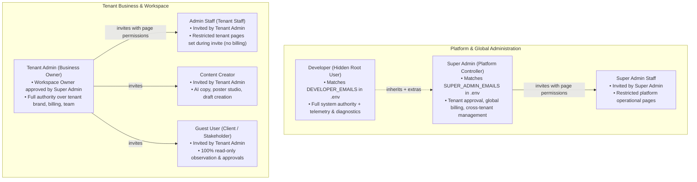

# User Roles, Permissions & 4-Tier Dashboard Architecture

This document defines the 7 user roles, their hierarchical relationships, permission models, and the 4 dedicated dashboard experiences in ABCD Social Hub.

---

## 1. The 7 User Roles Hierarchy



---

## 2. Role Specifications & Capability Matrix

| Role Key | Name | Authority Scope | Capabilities | Restrictions |
|---|---|---|---|---|
| `DEVELOPER` | Developer | Global Root (Hidden) | All Super Admin capabilities + raw database diagnostics, queue worker telemetry, LLM token ledger, error traces, internal system sandbox. | None. Single or comma-separated email configured in `.env`. |
| `SUPER_ADMIN` | Super Admin | Global Platform | Cross-tenant visibility, approving new tenant workspaces, global revenue aggregates, user suspension, founder growth cockpit (`/admin/marketing`). | Cannot access raw server infrastructure/developer engine. |
| `SUPER_ADMIN_STAFF` | Super Admin Staff | Global Platform (Delegated) | Operational tasks permitted by Super Admin (e.g. tenant KYC verification, support tickets, content moderation). | Barred from global billing payouts, secret rotation, and unassigned admin pages. |
| `TENANT_ADMIN` | Tenant Admin (Business Owner) | Workspace / Tenant | Full tenant control: Brand Kit, WhatsApp CRM, social channel OAuth, publishing queue, subscription & billing, inviting team. | Barred from cross-tenant data and platform-wide settings. |
| `ADMIN_STAFF` | Admin Staff (Tenant Staff) | Workspace / Tenant (Delegated) | Inbound leads CRM, booking schedules, post draft review, and pages specifically enabled during invite. | Barred from billing, subscription cancellation, team role demotions, and encrypted channel secrets. |
| `CREATOR` | Content Creator | Workspace Creative | AI copywriting, Bengali/Hindi poster designer, campaign drafting, submitting posts for approval. | Barred from leads CRM, billing, team management, and channel connection keys. |
| `GUEST` | Guest User | Workspace Observation | Read-only access to Autopilot performance briefing, published campaign reach metrics, and calendar preview. | 100% read-only. Cannot create, edit, delete, or trigger any publish or billing action. |

---

## 3. The 4 Dashboard Experiences

ABCD Social Hub dynamically renders one of 4 dashboard layout modes based on the active user's role:

### Type 1: Super Admin Suite (`/admin/*`)
- **Target Users**: `DEVELOPER`, `SUPER_ADMIN`, `SUPER_ADMIN_STAFF`
- **Theme & Aesthetic**: Sovereign Gold / Amber accents, platform-scale KPIs.
- **Navigation**:
  - Global Overview (`/admin`)
  - Workspace Approvals & Tenants (`/admin/tenants`)
  - Platform Revenue & Quotas (`/admin/billing`)
  - Founder Marketing Cockpit (`/admin/marketing`)
  - Platform Team (`/admin/staff`)
  - *(Developer Only)* System Diagnostics & Telemetry (`/admin/diagnostics`)
- **Mobile Bottom Nav**: [Overview] [Tenants] [Cockpit] [Staff/Diag]

### Type 2: Tenant Business Suite (`/dashboard`)
- **Target Users**: `TENANT_ADMIN` (Owner), `ADMIN_STAFF` (Staff)
- **Theme & Aesthetic**: Professional Slate / Cyan Primary accents, daily business growth.
- **Navigation**:
  - Autopilot Report (`/dashboard`)
  - Content Studio (`/content`)
  - Publishing Queue (`/calendar`)
  - Social Channels (`/social`)
  - Brand Identity Kit (`/brand`)
  - WhatsApp Leads CRM (`/leads`)
  - Team & Roles (`/team`)
  - *(Tenant Admin Only)* Billing & Plans (`/billing`)
- **Mobile Bottom Nav**: [Report] [Content] [Calendar] [Leads]

### Type 3: Creator Studio (`/dashboard`)
- **Target Users**: `CREATOR`
- **Theme & Aesthetic**: Creative Emerald / Violet accents, visual-first canvas.
- **Navigation**:
  - Creative Studio (`/content`) — AI copywriting, multi-channel caption generator
  - Regional Poster Studio (`/content/posters`) — Bengali/English poster canvas
  - Publishing Timeline (`/calendar`) — View scheduled posts and submission statuses
  - Brand Assets (`/brand`) — Read-only brand guidelines, logos, and color palettes
- **Mobile Bottom Nav**: [Studio] [Posters] [Calendar] [Brand]

### Type 4: Guest / Client Portal (`/dashboard`)
- **Target Users**: `GUEST`
- **Theme & Aesthetic**: Clean Minimalist, distraction-free executive overview.
- **Navigation**:
  - Performance Briefing (`/dashboard`) — High-level reach, engagement, and follower charts
  - Scheduled Feed (`/calendar`) — Read-only feed preview of upcoming scheduled content
  - Brand Profile (`/brand`) — Brand assets preview
- **Mobile Bottom Nav**: [Report] [Feed] [Profile]

---

## 4. Permission Storage & Session Resolution

### Database Model (`packages/db/prisma/schema.prisma`)
```prisma
enum Role {
  DEVELOPER
  SUPER_ADMIN
  SUPER_ADMIN_STAFF
  TENANT_ADMIN
  ADMIN_STAFF
  CREATOR
  GUEST
}

model Membership {
  id             String    @id @default(cuid())
  userId         String
  organizationId String
  role           Role      @default(TENANT_ADMIN)
  allowedPages   String[]  @default([]) // Granular page permissions for STAFF
  createdAt      DateTime  @default(now())
  ...
}
```

### NextAuth Session Injection (`apps/web/lib/auth.ts`)
- Server identifies:
  1. Is email in `DEVELOPER_EMAILS`? $\rightarrow$ Role `DEVELOPER`
  2. Is email in `SUPER_ADMIN_EMAILS`? $\rightarrow$ Role `SUPER_ADMIN`
  3. Otherwise $\rightarrow$ `Membership.role` from database.
- Injects: `(session.user).role`, `(session.user).allowedPages`, `(session.user).dashboardType`.

