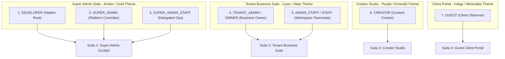

# ABCD Social — Complete User Roles, Dashboards & Navigation Architecture Report

**Document Generated**: October 31, 2026  
**System Version**: ABCD Social Hub v0.1.0-alpha (PostgreSQL 16, Prisma ORM, NextAuth JWT RBAC)  
**Target Repository**: `abcd-social-hub-monorepo`  

---

## 1. Executive Summary & Hierarchy

ABCD Social is structured around **7 User Roles** categorized into **4 Tailored Dashboard Suites**. Each suite presents a purpose-built sidebar navigation hierarchy, mobile bottom dock, and cryptographic server-side route guards.



---

## 2. Master Matrix: Roles, Dashboards, Menus & URL Routes

| Role Name | Suite | Sidebar Menu Groups & Links | Mobile Dock (4-Icon) | Key Access Capabilities | Hard Restrictions |
|---|---|---|---|---|---|
| **1. DEVELOPER** | **Super Admin Suite** | **Platform Core**: Overview (`/dashboard`), Founder Cockpit (`/admin/marketing`)<br>**Workspace Mgmt**: Tenant Workspaces (`/admin/tenants`), Team & Admins (`/team`), Social (`/social`), Billing (`/billing`)<br>**Developer Engine**: Diagnostics & Logs (`/admin/diagnostics`) | Overview, Cockpit, Tenants, Diagnostics | Full root access, live query logs, heap memory audit, worker queues, tenant approvals, simulated role switcher. | None (Root user). |
| **2. SUPER_ADMIN** | **Super Admin Suite** | **Platform Core**: Overview (`/dashboard`), Founder Cockpit (`/admin/marketing`)<br>**Workspace Mgmt**: Tenant Workspaces (`/admin/tenants`), Team & Admins (`/team`), Social (`/social`), Billing (`/billing`) | Overview, Cockpit, Tenants, Team | Approve/suspend tenant businesses, Harvey lead prospector, platform-wide economics, invite Super Admin Staff. | Barred from Developer Diagnostics panel. |
| **3. SUPER_ADMIN_STAFF** | **Super Admin Suite** | Filtered by assigned `allowedPages` (`tenants`, `marketing`, `billing`) | Overview, Allowed Pages, Team | Delegated platform moderation, workspace approval reviews, marketing prospector. | Barred from developer diagnostics, global secret keys, payout bank accounts. |
| **4. TENANT_ADMIN** *(In your screenshot)* | **Tenant Business Suite** | **Main Menu**: Autopilot Report (`/dashboard`), Content Studio (`/content`), Publishing Queue (`/calendar`)<br>**Channels**: Social Channels (`/social`), Brand Kit (`/brand`)<br>**CRM & Growth**: WhatsApp Leads (`/leads`), Billing & Plans (`/billing`)<br>**Administration**: Team & Roles (`/team`) | Report, Studio, Calendar, Leads | Full authority over business workspace: AI generation, Bengali posters, publishing queue, WhatsApp CRM, billing & upgrades, team invites. | Cannot view or modify other tenant workspaces or platform admin cockpit. |
| **5. ADMIN_STAFF** | **Tenant Business Suite** | Filtered dynamically by Tenant Admin invite permissions (`leads`, `calendar`, `content`, `social`, `brand`) | Report, Assigned Page 1, Assigned Page 2, Team | Inbound WhatsApp lead engagement, calendar review, scheduled post inspections. | **Strictly barred from `/billing`**, subscription upgrades, and encrypted platform keys. |
| **6. CREATOR** | **Creator Studio** | **Creative Studio**: Content Studio (`/content`), Publishing Calendar (`/calendar`), Autopilot Report (`/dashboard`)<br>**Brand Guidelines**: Brand Identity Kit (`/brand`) | Studio, Calendar, Report, Brand | Regional AI copy generator, Noto Sans Bengali festive posters, Instagram carousels, WhatsApp promo blasts, drafts queue. | **Strictly barred from `/billing`**, WhatsApp CRM leads (`/leads`), team administration (`/team`). |
| **7. GUEST** | **Client Portal** | **Executive Portal**: Performance Briefing (`/dashboard`), Scheduled Feed (`/calendar`), Brand Guidelines (`/brand`) | Briefing, Feed, Brand, Profile | High-level performance briefing, estimated audience reach, read-only upcoming post timeline, brand compliance audit. | **100% Read-Only**: Barred from content creation, post editing, deleting, rescheduling, billing, CRM, team settings. |

---

## 3. Deep-Dive: The 4 Dashboard Suites & Menu Details

### Suite 1: Super Admin & Developer Suite
**Target Users**: `DEVELOPER`, `SUPER_ADMIN`, `SUPER_ADMIN_STAFF`  
**Accent & Badges**: Amber `#F59E0B` & Rose `#F43F5E`  
**Sidebar Navigation Tree**:
```text
├── PLATFORM CORE
│   ├── [LayoutDashboard] Platform Overview         -> /dashboard
│   └── [Rocket]          Founder Cockpit           -> /admin/marketing (Badge: Admin)
├── WORKSPACE MANAGEMENT
│   ├── [Building2]       Tenant Workspaces         -> /admin/tenants   (Badge: Tenants)
│   ├── [Users]           Team & Admins             -> /team
│   ├── [Share2]          Social Channels           -> /social
│   └── [CreditCard]      Platform Billing          -> /billing
└── DEVELOPER ENGINE (Visible only to DEVELOPER)
    └── [Sparkles]        Diagnostics & Logs        -> /admin/diagnostics (Badge: Root)
```
* **Top Header Tabs (Admin View)**:
  1. `Founder Cockpit` (`/admin/marketing`) — Unit economics modeling, Harvey Kolkata lead prospector.
  2. `Tenant Workspaces` (`/admin/tenants`) — 1-click Approve / Suspend toggle for tenant workspaces.
  3. `Developer Diagnostics` (`/admin/diagnostics`) — Node.js memory heap, database pool, environment audit.
* **Top Persona Simulator Bar**:
  Allows Developers & Super Admins to simulate any of the 7 roles on the fly without logging out.

---

### Suite 2: Tenant Business Suite (Your Current View in Screenshot)
**Target Users**: `TENANT_ADMIN` (Business Owner), `ADMIN_STAFF` (Teammate)  
**Accent & Badges**: Cyan `#00F0FF` & Slate  
**Sidebar Navigation Tree**:
```text
├── MAIN MENU
│   ├── [LayoutDashboard] Autopilot Report          -> /dashboard
│   ├── [ImageIcon]       Content Studio            -> /content
│   └── [Calendar]        Publishing Queue          -> /calendar
├── CHANNELS & CAMPAIGNS
│   ├── [Share2]          Social Channels           -> /social
│   └── [Palette]         Brand Identity Kit        -> /brand
├── CRM & GROWTH
│   ├── [MessageSquare]   WhatsApp Leads            -> /leads     (Badge: Live)
│   └── [CreditCard]      Billing & Plans           -> /billing   (Hidden for ADMIN_STAFF)
└── ADMINISTRATION
    └── [Users]           Team & Roles              -> /team
```
* **Page Features**:
  1. `/dashboard`: The Autopilot Command Center with 4 KPI cards (Published, Queue, Review, Credits), live Meta/LinkedIn channel health, and 3-column AI report.
  2. `/content`: Interactive AI copywriting, Pillow-rendered posters with Noto Sans Bengali typography, Edge-TTS audio voiceovers.
  3. `/calendar`: Scheduled publishing timeline in IST (`Asia/Kolkata`) with manual override dispatches.
  4. `/leads`: Indian local business customer CRM with WhatsApp click-to-chat.
  5. `/billing`: Razorpay subscription plan management and credits ledger.
  6. `/team`: Team seats management with granular page permission checkboxes.

---

### Suite 3: Creator Studio
**Target Users**: `CREATOR`  
**Accent & Badges**: Purple `#A855F7` & Emerald `#10B981`  
**Sidebar Navigation Tree**:
```text
├── CREATIVE STUDIO
│   ├── [ImageIcon]       Content Studio            -> /content   (Badge: AI)
│   ├── [Calendar]        Publishing Calendar       -> /calendar
│   └── [LayoutDashboard] Autopilot Report          -> /dashboard
└── BRAND GUIDELINES
    └── [Palette]         Brand Identity Kit        -> /brand
```
* **Dashboard View**:
  * **Header**: "Creator Studio" — *"Draft AI copy, design regional posters, schedule."*
  * **4 Metrics**: Drafts in Progress, Scheduled Queue, Published Live, Total Creations.
  * **Quick AI Generator Hub**:
    1. *Bengali Festive Poster* (1080×1080 square canvas, Noto Sans Bengali font, festival themes).
    2. *Instagram Carousel Script* (multi-slide storytelling with hook & body).
    3. *WhatsApp Promo Copy* (direct conversion offer messages).
  * **Creative Review Pipeline**: Active status tracking of posts awaiting business owner or client sign-off.
  * **Brand Identity Palette**: Instant visual display of primary brand colors, tagline, and font specifications.

---

### Suite 4: Guest Client Portal
**Target Users**: `GUEST` (Client Observer, Investor, Auditor)  
**Accent & Badges**: Indigo `#6366F1` & Purple `#A855F7` (Minimalist Executive)  
**Sidebar Navigation Tree**:
```text
└── EXECUTIVE PORTAL
    ├── [LayoutDashboard] Performance Briefing      -> /dashboard
    ├── [Calendar]        Scheduled Feed            -> /calendar
    └── [Palette]         Brand Guidelines          -> /brand
```
* **Dashboard View**:
  * **Header**: "Client Portal" — *"Review brand performance, scheduled campaigns, audience reach."*
  * **Observer Pill**: Prominent `Client Observer • Read Only` lock badge.
  * **4 Metrics**: Estimated Reach (e.g. 24.5K views), Live Campaigns, Upcoming Queue, 100% Brand Safety Compliance.
  * **Growth Chart**: Performance trajectory area chart showing audience reach over time.
  * **Upcoming Campaign Schedule**: Clean preview cards with publication date/time in IST (`Asia/Kolkata`).
  * **Strict Observer Barrier**: Zero create/edit/delete/publish buttons. If a Guest attempts to visit `/content`, `/leads`, or `/billing`, they receive an informative Access Restricted card.

---

## 4. Mobile Bottom Navigation Docks (App-Style 4-Icon Layout)

On viewports below `768px` (mobile devices), the persistent bottom dock dynamically switches icons according to the active suite:

```text
[ Super Admin Suite ]     ->  [Overview]    [Cockpit]    [Tenants]    [Team]
[ Tenant Business Suite ] ->  [Report]      [Studio]     [Calendar]   [Leads]
[ Creator Studio ]        ->  [Studio]      [Calendar]   [Report]     [Brand]
[ Guest Client Portal ]   ->  [Briefing]    [Feed]       [Brand]      [Account]
```

---

## 5. Security & Permission Enforcement Rules

1. **Prisma Scoping**: Every database query is cryptographically bound to `workspaceId`. Direct un-scoped queries from actions or components are blocked.
2. **Staff Permission Isolation**:
   * When an `ADMIN_STAFF` is invited, the Tenant Admin checks off accessible pages (`leads`, `calendar`, `content`, `social`, `brand`).
   * If a staff member attempts to access an unchecked page (e.g., `/content` when only granted `/leads`), the server middleware renders the semantic Access Restricted view.
3. **Financial Protection**:
   * The `/billing` and `/api/billing` routes strictly verify `role === "TENANT_ADMIN" || role === "OWNER" || role === "SUPER_ADMIN" || role === "DEVELOPER"`. Staff, Creators, and Guests receive `403 Forbidden`.
4. **CRM Phone Protection**:
   * The `/leads` endpoint is barred from Creators and Guests.

---

## 6. How to Switch & Test Any Role

To test how any role experiences the menus and dashboard views:
1. Log in with the Developer / Super Admin account (`suman.baidya.pro@gmail.com`).
2. Notice the **Role Persona Simulator** bar at the top of the screen.
3. Click **"Switch Role"** and select any role:
   * Select `CREATOR` to see the **Creator Studio** menus and AI poster generators.
   * Select `GUEST` to experience the **Client Portal** with read-only observer protection.
   * Select `SUPER_ADMIN` to manage tenant business approvals.
   * Select `TENANT_ADMIN` to return to the full Business Owner suite.
4. Click **"Reset"** to return to your real account at any time.

